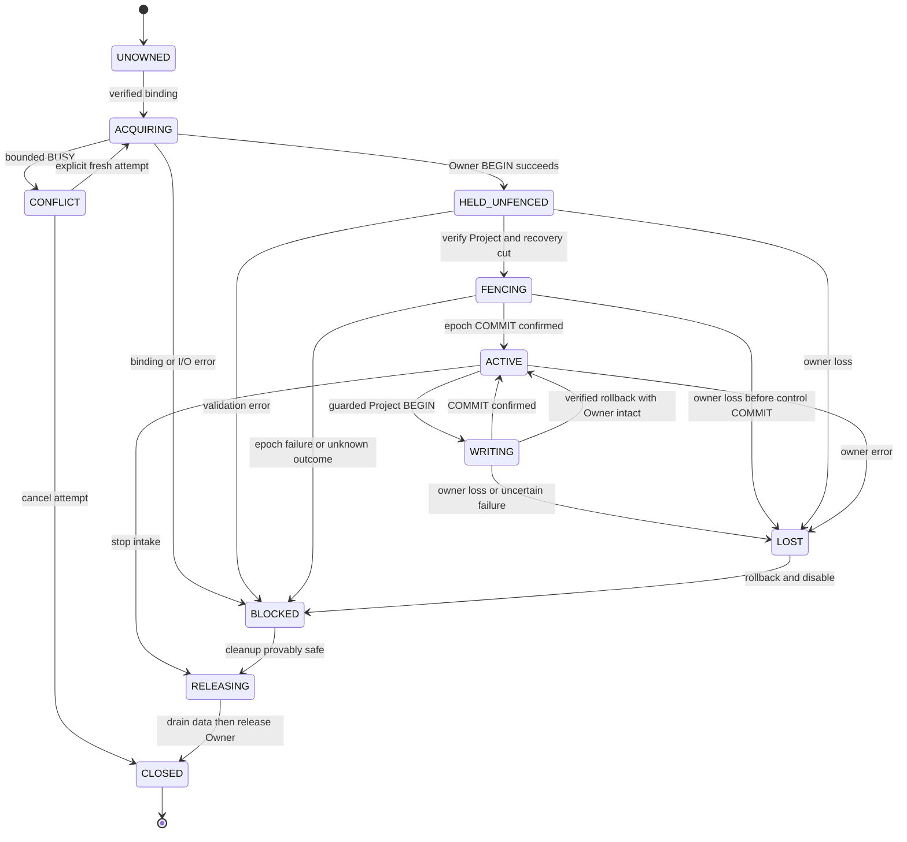

# Phase 2.3 — Disposable SQLite Ownership Spike: Pre-execution Design

**Public-safe publication copy (2026-10-19).** The original private preparation document bytes are retained separately. Original SHA256: `ff09d82b8b5aaf5a0b3771e3266cd86346bfac57c51994994e4fbd8a05c7bbe2`. Machine prefixes below use `%APV_REPO%` (repository root), `%LOCALAPPDATA%` (original account's local app-data root), `%ProgramFiles%` and `%APV_CLANG_EXE%` (the recorded Clang executable), where applicable. These are publication aliases, not literal historical command bytes or newly observed paths. RunIds, build/binary fingerprints, results and limitations are unchanged. This copy is not a new execution authorization.

**Status: Proposed / execution not authorized / every case NOT TESTED.** Date: 2026-10-08.
Direction has conditional architecture approval; this protocol and its implementation/execution still require separate review/authorization. D-041–D-044 remain Proposed. No runner, helper, database, dependency or process experiment is created/run by this document.

**Implementation authorization update, 2026-10-09:** user approved the design and authorized disposable harness implementation only. [Implemented harness / CMD guide](../../experiments/phase-2-sqlite-ownership-spike/README.md) now exists; real OP01–OP10 execution remains unauthorized and NOT TESTED. D-041–D-044 remain Proposed. The original pre-execution design below is retained; current file/command availability is superseded by that README. No databases/workers/faults were run during preparation; only pure JS/static checks and a read-only preflight (blocked by sandbox EPERM at temporary-root metadata).

Related: [Storage design §6.1](../storage/phase-2.3-design.md), [25-case acceptance protocol / O01](../acceptance/phase-2-storage.md), [D-042](../../DECISIONS.md).

**Closure gap preparation update, 2026-10-09:** the original design/NOT TESTED statements describe their historical preparation stage. The user has confirmed separately executed, scoped PASS WITH LIMITATION audits for OP01–OP10. Current scope/gaps and immutable run references are in the [closure coverage matrix](sqlite-ownership-closure-coverage.md); this is not complete O01/25-case acceptance or Decision approval. The original OP10 covers only bounded Owner contention and successful parked release. Its CMD exit code remains unverified.

The user now authorizes implementing **only** OP10 `project_busy_watchdog` and pure/static checks, not executing it. The [current README](../../experiments/phase-2-sqlite-ownership-spike/README.md#closure-gap-preparation--2026-10-09) defines actual Project BEGIN contention, unchanged fail-closed fencing, a separate parent 5 s watchdog observation, complete cleanup and four independent Reader checkpoints. The failed candidate stays BLOCKED without fencing retry; a fresh instance alone can recover after release. The 250 ms SQLite BUSY limit and the parent watchdog are separate. This new real scenario is **NOT TESTED**. Real Owner release failure also remains NOT TESTED; paused release cannot substitute for it. No hidden-lock-loss, two-file atomicity or production support promise changes.

**OP04 targeted coverage authorization update, 2026-10-09:** only disposable harness/test and coverage documentation changes are authorized; no real fault execution is authorized in this task. Enhanced idle/pre/post scenarios are **NOT TESTED**. Existing OP04 RunId `e39f313b-2e42-4d13-9b1b-fdd0f611627a` and OP05 RunId `597413fe-87c6-46f2-93e1-d08571492dc5` remain immutable historical evidence with their original source hashes. Their audited PASS WITH LIMITATION does not cover this revised harness. The original design/preparation scope statements are historical; current OP04 checkpoint details and the execution command are in the [targeted README update](../../experiments/phase-2-sqlite-ownership-spike/README.md#op04-targeted-coverage-update--2026-10-09).

The coverage extension adds independent SQL reads after B's new business commit in every OP04 variant and after the post variant's duplicate retry. Idle/pre must first prove no A business row survived, then prove exactly one B e2/new-token O1. Post must prove A e1/token O1 survived; duplicate O1 leaves the full SQL cut unchanged; final O1/O2 rows appear exactly once with their respective author epochs/tokens and head 2. Commit/publication/fixture ACK receipts must match those records, with no A ACK or duplicate ACK. Reader checkpoints, timestamps and parent order are saved through existing evidence paths. No ownership/fencing/ACK rule, runtime schema or support boundary is altered; hidden locking/file races remain NOT GUARANTEED, and all full Storage S/P/M gates remain pending. New runs must use fresh IDs and capture the revised source hashes; never infer enhanced coverage from old artifacts.

## 1. Question, supported assumptions and explicit gap

Question: can one held SQLite Owner DB transaction, a separate short Project DB transaction and persisted fencing epoch provide safe **cooperative** ownership through competition, release, crash and retry? Proving SQLite serializes one file is insufficient.

Proposed initial probe scope: ordinary Node on a real local Windows x64 filesystem, better-sqlite3 13.0.3, synthetic fixtures, two writer processes A/B and a fresh reader C. No Core import/changes, user Project data, Host/VSIX, network, live Agent transport or full production persistence schema. Record actual runtime/SQLite/VFS-related scope; archived compatibility is not ownership evidence.

Necessary assumptions to be tested where executable:

- All participating writers follow the protocol; their private ownership and project connections are confined to the same serialized thread. No untrusted SQL, callbacks, shared worker handles or helper process can close them independently.
- All participants resolve the same stable physical Owner file and the same Project DB/generation. Local supported filesystem locking works; no process changes lock files or aliases while in use.
- An epoch is **not** an instant revocation signal. It protects against a stale token only after the new epoch commits in the Project DB.

**Counterexample / mandatory design gap:** A holds Project BEGIN IMMEDIATE at epoch e. A releases Owner transaction but keeps its Project transaction. B acquires Owner and tries to set epoch e+1, but blocks on A's Project lock. If A blindly commits, it can commit at e **after losing Owner**, before B can fence it. Checking only the Project token at transaction start/end does not prevent this. No test waiver or two-file atomicity claim resolves the gap.

Proposed mitigation for observable/controlled loss: private lifecycle control prevents normal release during a data section; the data section checks Owner open/held-transaction/lifecycle both before BEGIN and immediately before COMMIT, and rolls back on loss. The final check and COMMIT are synchronous, non-reentrant and adjacent. Any caught owner error permanently disables the instance. §5 specifies the exact protocol and the negative control.

**Still not guaranteed:** `.open`/`.inTransaction` describes the connection, not a kernel attestation that the underlying lock/file is still the intended resource. Undetectable OS/VFS lock loss, out-of-band handle manipulation, TOCTOU file replacement or arbitrary protocol-bypassing SQL cannot be made safe by a second epoch field. Supporting those failure modes requires another reviewed architecture, not an exception in PASS rules. This remains a production safety gap until the required threat/support scope and lifecycle enforcement are explicitly approved and evidenced.

## 2. Paths, binding and lifetime

The future runner creates a new owned root, never accepts a supplied real project/DB path:

```text
<local-temp>/apv-sqlite-ownership/<RunId>/<CaseId>/
  binding.json                         synthetic immutable binding fixture
  ownership/<StoreKey>/owner.sqlite    stable across generations of this binding
  projects/<StoreKey>/<Generation>/project.sqlite
  evidence/                            fresh append-only receipts/oracles
```

The root must resolve outside the APV/user repositories, under a reviewed local temp location, with no UNC/reparse escape. An unsupported TEMP location stops the run; do not silently fall back into a project directory. Binding includes synthetic ProjectId, stable StoreKey, active Generation, canonical root/path and expected file marker/identity. Directory/usernames are not public receipt fields; use synthetic relative aliases in public derivatives. Full private evidence stays in the owned root.

One parent establishes the immutable binding before spawning children; this probe does not implement the production installation catalog. Distinct writers must resolve the **same** binding/owner path; casing or generation changes do not allocate a new Owner file. Production concurrent catalog initialization remains the separate O01-a/P03 integration gate.

Canonicalization/checks: absolute resolution, realpath of existing ancestors/files, reviewed Windows path/case handling, file/directory type and no reparse escape, constant marker/schema and expected physical file identity where available. String normalization or a matching copied marker cannot prove two open handles refer to the same file. Necessary unreadable identity/permission checks block acquisition. Capture identity before opening/at safe boundaries; never read/hash a live SQLite file through ad-hoc descriptors as a claimed lock proof. Physical identity/deny-replacement properties are Windows evidence requirements, not assumed cross-platform facts.

For reproducible fixture admission, parent records canonical absolute paths and available file/directory identity once initialization is closed; children resolve and compare the supplied binding rather than invent their own generation path. Only those predetermined local paths are accepted. A case-only/alternate-name input must either resolve to that exact supported identity without creating another lock or be rejected; unknown equivalence is rejection. Collect identity via reviewed filesystem metadata operations, not a second raw file reader/hasher during held locks. Safe-boundary checks cannot eliminate a change between check and use; OP09 must expose the actual OS behavior and this remaining TOCTOU limitation.

Owner file is independent of Generation; Project binding+generation is rechecked on acquisition and every data transaction. Ordinary release/crash leaves Owner file in place. No deletion, rename, replacement or creation-as-repair while existing participants might reference it. A missing/corrupt existing-bound owner file is blocked. Only fresh fixture setup may initialize it; completed evidence/DBs are preserved, no automatic cleanup.

## 3. Minimal disposable data, not production schema

| File / table               | Proposed fields and purpose                                                                                                                                                                                       |
| -------------------------- | ----------------------------------------------------------------------------------------------------------------------------------------------------------------------------------------------------------------- |
| Owner DB `owner_meta`      | One constant magic/schemaVersion/StoreKey row, initialized before the held transaction. No epoch, process/PID heartbeat, business data or lease. journal_mode=DELETE                                              |
| Project DB `store_meta`    | One row: synthetic ProjectId, Generation, active lifecycle, writerEpoch (initial 0), ownerToken (absent before first acquisition), fixture head/digest. **Authoritative epoch/token live here**, journal_mode=WAL |
| Project DB `fixture_state` | Small deterministic counter/body + digest; stands in for one business transition, not Core/Plan/Timeline implementation                                                                                           |
| Project DB `writes`        | Unique operationId, stable intent digest, committed epoch/token audit reference, base/new head and result digest. Demonstrates commit/duplicate outcome across owners                                             |

Use synchronous=FULL on the Project connection; verify foreign keys, journal modes and settings. Proposed lock busy_timeout=250 ms; evidence records actual timings. Safe integer epoch/head, no wrapping/reuse; overflow rejects. Token is a fresh opaque random nonce scoped by Project/Generation/epoch, not PID/time. Serialize numbers safely; no probability/security guarantee against malicious same-user processes is claimed.

The probe writes no actual NormalizedEvent/Assertions/snapshot or source cursor. An optional independent **fixture ACK** records only a committed operation nonce after SQL COMMIT; it does not prove real source acknowledgment. Full S/P/M persistence cases remain separate.

## 4. Ownership state machine and invariants



State meanings:

- HELD_UNFENCED owns the lock but has **no business write/publication/ACK capability**. It cannot reuse the former writer's token.
- FENCING confirms a new project epoch. Failure stays blocked/held for safe reconciliation or release; no ACTIVE from a successful Owner BEGIN alone.
- WRITING owns one short Project transaction; release requests are queued/rejected until commit/rollback and data closure finish. Unexpected observable loss takes LOST before any further data SQL except rollback/reconciliation.
- RELEASING cancels queued candidates; close/drain Project connection first, invalidate capability, then ROLLBACK/close Owner. Closed/lost instances never reconnect to resume old work.
- A confirmed fully closed instance may start a **new acquisition instance** with new token/epoch after successful lock acquisition; it does not resurrect prior candidates.
- Process termination ends that process's capability. B must successfully acquire the real Owner lock and inspect Project recovery; PID disappearance alone gives no transition. If release/rollback/close cannot be established, BLOCKED remains and no takeover shortcut is used.
- Unknown Project COMMIT outcome remains blocked: inspect a healthy DB/operation receipt under valid ownership, never publish based on cached candidate. If the Owner connection is lost, this instance cannot perform new writable reconciliation; a new owner handles it.

Key invariants (properties to test under the stated assumptions, **not verified guarantees**):

1. At most one **participating ACTIVE writer** per stable binding; HELD_UNFENCED is not ACTIVE. Readers are allowed but receive one consistent committed cut.
2. Every data COMMIT requires a live held Owner acquisition instance, matching Project/generation/epoch/token and correct expected base; guard failures roll back all fixture state/receipt changes.
3. Loss/close/release invalidates the instance permanently; no old capability remains usable even if a new epoch has not yet committed.
4. Owner lock and Project COMMIT are separate resources. There is no atomic transaction across both files and no instantaneous DB-only lock revocation.
5. Every takeover restores the last complete Project cut before intake, commits a new epoch, and discards/recomputes new work; receipt-based retries may recognize old committed work without restoring an old head.
6. Publication/fixture ACK happens only for verified committed operations. A stopped/lost writer does not publish pending data; the next valid owner can reconcile a prior committed receipt.
7. Binding/generation conflict, unknown outcome, missing evidence and quota/I/O failure never become empty success or force takeover.

## 5. Transaction timing, epoch and final guard

All SQL below describes the future experiment; it is not executed in this review. Use raw transactions consistently on distinct connections; do not mix a Driver-managed transaction callback with raw COMMIT/ROLLBACK.

| Step | Owner connection                                                                                                      | Project connection / ability                                                                                                                                                                                                         |
| ---- | --------------------------------------------------------------------------------------------------------------------- | ------------------------------------------------------------------------------------------------------------------------------------------------------------------------------------------------------------------------------------ |
| 1    | Validate binding/marker; BEGIN IMMEDIATE succeeds                                                                     | No data writes; HELD_UNFENCED                                                                                                                                                                                                        |
| 2    | Hold transaction, no DML/renewal/COMMIT                                                                               | Validate supported G/active cut; read recovery oracle                                                                                                                                                                                |
| 3    | Still held; final open/transaction/FENCING-instance guard before control COMMIT too                                   | BEGIN IMMEDIATE; read current epoch under write lock; compare generation/lifecycle; set e+1 and fresh token with conditional singleton update against the read e/G; verify one affected row; final Owner guard then immediate COMMIT |
| 4    | Still held                                                                                                            | Confirm persisted e+1/token; only then ACTIVE. Epoch-only commit changes no fixture business head                                                                                                                                    |
| 5    | Check open/inTransaction + ACTIVE acquisition instance                                                                | BEGIN IMMEDIATE; read generation/epoch/token; receipt lookup; matching old operation resolves before base check; otherwise verify expected head                                                                                      |
| 6    | Remains held, lifecycle cannot release                                                                                | Apply fixture body/receipt; conditional head update includes expected generation/epoch/token/base, require exactly one affected row                                                                                                  |
| 7    | **Final guard last:** same ACTIVE instance, open + inTransaction, no owner error/release, supported unchanged binding | First verify Project token/guarded result; then final Owner guard and **immediately COMMIT** in the same synchronous non-reentrant section, no await/user hook/IPC call between final guard and COMMIT                               |
| 8    | Held through verified outcome/publish                                                                                 | Confirm committed receipt; publish committed cut/fixture ACK outside SQL; receipt history does not rewind newer head                                                                                                                 |
| 9    | ROLLBACK/close only after data drain/closure and capability invalidation                                              | No writable queued work; CLOSED                                                                                                                                                                                                      |

Epoch update rules: new owner reads e from the actual Project DB under its write transaction and sets e+1; nonce token binds that acquisition. It is never derived from PID/timestamp/Owner file contents. Epoch failure/rollback leaves the old e but does not let the new process become ACTIVE. For uncertain epoch COMMIT, query its **proposed nonce** under retained Owner lock from a healthy fresh Project connection: match proves that control commit, verified absence proves it did not commit, contradictory/unreadable result blocks. This conservative probe keeps the errored instance BLOCKED even after reconciliation: complete safe closure/release, then use a new acquisition and a new epoch before ACTIVE. Do not retry another increment or reuse another writer's token blindly.

Before-domain and final-guard failures rollback the Project transaction if possible, cancel any publication/ACK and permanently disable the acquisition instance. The same live-Owner final guard applies to epoch-control commits while FENCING; ACTIVE is not required before fencing, but lock loss must reject that control write too. If rollback outcome is unknown, retain originals and let a new properly acquired owner verify recovery. A data SQLException also checks whether its Project transaction still exists; no subsequent writes run in presumed-but-rolled-back SQL scope.

**Adversarial interleaving:** A WRITING at e; controlled owner rollback/close; B gets Owner, enters HELD_UNFENCED, Project BEGIN returns BUSY; A's final Owner guard detects loss and rolls Project back; B later confirms recovery/fences e+1 and becomes ACTIVE. A's stale request cannot write either before e+1 (local instance disabled) or after e+1 (DB fence fails). A raw rogue SQL connection ignoring these guards can still write; it is a counterexample, not an allowed production caller.

If loss occurs only **after the final guard** via an independent thread/native component/file-system failure, the two-file mechanism alone cannot make the check and COMMIT atomic. The no-reentrancy/private-connection invariant rules out controlled application release in that interval; it does not solve hidden external loss. The experiment must report this unmet stronger property separately, never infer it from OP06 passing.

For lock contention: proposed Owner timeout 250 ms, no automatic owner retry loop; return conflict/read-only. A later explicit attempt can succeed after evidence of real release, never by forcing release. Project BUSY while holding Owner returns BLOCKED/held; one separately scheduled fresh attempt is permitted after the previous Project transaction is known ended, with a proposed total case watchdog 5 s. Watchdogs terminate only harness-owned children after verified handshake; timeouts do not authorize production takeover. B must not hold a Project write lock before acquiring Owner, avoiding inverted protocol lock order.

## 6. Reproducible process harness proposal

Parent creates a unique RunId/case root and immutable synthetic binding, starts A/B as new Node child processes, and starts independent reader C only after the relevant commit/rollback/process-exit evidence. Children load the already installed local Driver read-only through its existing spike package resolution; no installation, pnpm configuration or archived evidence writes. Record actual binary/runtime/schema/source hashes and OS/architecture.

Control barriers: owner_begin_ok, recovery_verified, before_epoch_commit, after_epoch_commit_before_active, project_begin_ok, after_fixture_write, before_final_guard, after_project_commit_before_ack, before_owner_release. Parent/child handshake includes RunId/CaseId/WorkerInstanceId and nonce. Process identity uses owned child object/handle plus reported PID/creation information when available; PID alone does not permit a kill. No process-name cleanup.

To schedule another process while A holds a transaction, use a **test-only synchronous barrier** at the listed points: child writes a uniquely named entered receipt synchronously to its owned evidence directory, then waits/polls a separate nonce-bound release file from the parent. Parent starts B/observes its result and writes the release instruction. Each file is exclusive-create, bounded, non-reparse and validated by RunId/CaseId/WorkerInstanceId/barrier nonce. No dependence on an asynchronous IPC callback being serviced while A is blocked. No async SQLite transaction callback. After a before_final_guard barrier, Project verification precedes the final Owner guard and COMMIT with no more hooks. The control files are outside Owner/Project SQL and carry no business data. This deliberate pause is fixture scheduling, not an approved production yield inside transaction.

For controlled owner loss, a fixed test-only action on A's own thread ROLLBACKs/closes only its Owner connection before final guard. Standard lifecycle rejects/queues a normal release request in WRITING. These distinct subcases must not be conflated. For crash tests, parent requests forced termination of only the owned child and waits for actual exit before final reader. A kill request is not exit proof and does not by itself tell whether Project COMMIT happened.

Independent oracles: actual B acquisition result/state; SQL store_meta epoch/token/generation; fixture body/head/digest; complete writes receipt set and result; no uncommitted publication/ACK; A disable reason/state; old/new complete cut after owned process exit. Capture all transitions/SQL outcome categories, not just process exit 0. A correct negative control requires actual post-loss data COMMIT evidence to demonstrate the unfenced counterexample; it is recorded as **unsafe baseline**, never candidate success.

Proposed probe budgets (not product policy): 250 ms lock timeout, 5 s barrier/child watchdog, tiny fixture bodies, 32 MiB total artifacts per case and 512 MiB total owned run budget. Reaching limits stops without overwriting/removing receipts or advancing fixture state as a fake PASS. Settings/tolerances are in the future manifest; wall-clock scheduling jitter does not independently determine PASS. No automatic evidence cleanup.

Stop immediately on an unowned root/process, binding escape, unsafe raw diagnostic output, unexpected double-ACTIVE/candidate post-loss COMMIT, acceptance despite a failed final guard, evidence hash mismatch or unavailable required native/runtime support. An expected guard rejection/rollback in OP05/OP06/OP08 is its oracle, not itself a candidate failure. Preserve fresh originals and completed case receipts; do not rerun silently under the same IDs. Pure harness startup/observation failure is NOT TESTED; an actually observed protocol violation remains FAIL. Parent creates no process outside its run and never touches old Spike evidence.

## 7. Cases and expected verdicts — all NOT TESTED

| ID   | Deterministic schedule / required observation                                                                                                                                                                           | Candidate oracle and mapping                                                                                                                                                                                                                                                                                                         |
| ---- | ----------------------------------------------------------------------------------------------------------------------------------------------------------------------------------------------------------------------- | ------------------------------------------------------------------------------------------------------------------------------------------------------------------------------------------------------------------------------------------------------------------------------------------------------------------------------------ |
| OP01 | A acquires Owner, verifies G1, commits e1/token and one fixture operation; C reads                                                                                                                                      | ACTIVE only after e1 confirmed; exact state/receipt/e1, no pre-COMMIT publication. O01-a; ownership subset of S01                                                                                                                                                                                                                    |
| OP02 | A retains Owner; B attempts BEGIN with same binding                                                                                                                                                                     | B conflict/read-only within bounded result; no epoch/domain change or ACK. O01-a/e; not the complete S13 data-CAS test                                                                                                                                                                                                               |
| OP03 | A drains/closes data then Owner; B reacquires, restores and commits e2                                                                                                                                                  | A permanently CLOSED; B alone ACTIVE, old state/receipts preserved; no recycled token. O01-b                                                                                                                                                                                                                                         |
| OP04 | Force-terminate owned A at idle, pre-data-COMMIT and post-data-COMMIT/pre-ACK; B reacquires; independent recovery read; post additionally retries O1 and reads again; B commits a new operation; final independent read | Actual acquisition + exact recovery cut; duplicate cut unchanged; idle/pre contain only B e2/token O1; post contains A e1/token O1 and B e2/token O2 exactly once with matching head/digests and commit/publication/ACK receipts. Enhanced coverage NOT TESTED. O01-c; ownership subset S03–S05                                      |
| OP05 | After release/takeover, send saved e1/token request before and after B's e2; independently try mismatched generation                                                                                                    | Local lost/closed capability rejects before access; DB conditional guard rejects stale epoch/token/G with no state/receipt change. O01-b/d/g; P08 subset                                                                                                                                                                             |
| OP06 | A holds Project write transaction; normal release request is refused/deferred; separately inject controlled Owner rollback/close; B holds Owner but Project is BUSY                                                     | A final Owner guard rolls back whole data operation; B cannot ACTIVE before e2; after retry B sees old complete cut. Include **negative control** omitting final Owner guard to expose the §1 stale-epoch COMMIT counterexample; unsafe result remains labeled unsafe, not a waiver. O01-d/h; S02/S13 subset                         |
| OP07 | Schedule A valid COMMIT while it owns lock, then release/B fence/write; also schedule A stale queued write while B is fencing/active                                                                                    | Receipt/head ordering agrees with ownership transitions; no A write after capability loss, no simultaneous ACTIVE workers or lost update. O01-b/h; S13 subset                                                                                                                                                                        |
| OP08 | Kill A after Owner BEGIN, before epoch COMMIT and after epoch COMMIT/before ACTIVE; inject epoch SQL failure, controlled owner loss during epoch transaction and unknown outcome                                        | Control final guard rolls back on detected loss. B actually acquires, verifies old or committed epoch, increments from persisted value. No domain/ACK from unfinished acquisition; unknown epoch never activates blindly. O01-c/d; M04/S05 ownership-control subset                                                                  |
| OP09 | Give alternate/renamed/replaced/missing owner path, copied marker or G2 for same binding; attempt mutation of **owned** lock file while open                                                                            | Binding/identity mismatch blocks; Windows live-mutation attempt records actual deny/error or success. Unexpected replacement permitting two active owners is FAIL and support blocker; cannot normalize away/delete/recreate. If required physical identity cannot be measured, that subcase NOT TESTED. O01-f/g; P02/P03/P08 subset |
| OP10 | Park A with held Owner, B reaches lock timeout; alter synthetic PID/time/heartbeat diagnostics; later release/kill owned A and retry B                                                                                  | No PID/timeout takeover; explicit later acquisition/recovery/epoch succeeds. Recovery/acquisition Project BUSY exhausts watchdog without ACTIVE/publication. O01-e; M04 contention subset                                                                                                                                            |

OP06 negative control and OP09 mutation attempts are confined to sacrificial fixture cases, never user state or the live supported project. They do not authorize adding unsafe test hooks to production. Missing an executable case is NOT TESTED; a demonstrated candidate invariant violation is FAIL even when other cases pass.

## 8. Evidence and interpretation

Private original files: manifest.json, case/worker transition receipts (append-only fresh names), barrier observations, parent termination/exit receipts, fresh reader SQL oracle, per-case verdict, overall summary and artifact hash inventory under that RunId. No result file from another run or Phase 2.2 is reused. Record monotonic parent scheduling order plus UTC creation time; cross-process timestamps alone are not ordering proof.

PASS for a **case** requires its actual worker/barrier/SQL/reader evidence and every specified candidate invariant. FAIL takes precedence when an executed invariant is false. Harness/permission/module/GUI-independent process observation failure without a candidate observation is NOT TESTED, with exact safe failure category. An intentional unsafe negative control is separately identified; it never upgrades the candidate or suppresses an actual candidate failure.

Overall fields separate case statuses, cooperativeProtocolVerification, finalGuardVerification, realFileIdentityVerification, hiddenLockLossGuarantee (**NOT GUARANTEED**), platform/runtime scope, sourceAckIntegration (**NOT TESTED**), productionIntegration (**NOT TESTED**) and decisionAccepted:false. Even full cooperative case PASS cannot be labeled universal ownership safety or authorize D-041–D-044 acceptance/production implementation. Any required scope/lifetime/identity property not established blocks approval; do not use PASS WITH LIMITATION to waive a required safety invariant.

## 9. Original planned files and command interface (historical pre-execution design)

Only this design document and its cross-references exist after this review. After separate authorization, minimum proposed files under `experiments/phase-2-sqlite-ownership-spike/`:

The paragraph/commands in this section record the original design stage. Implementation is now authorized, with support/actors/scenarios and local lint configuration split out for safety/readability. Actual commands are in the harness README and require an explicit **--execute** flag for real cases; the original --case-only commands now print a NOT TESTED plan and create no Worker/DB. Execution authorization is still pending.

| Future file       | Responsibility                                                                                              |
| ----------------- | ----------------------------------------------------------------------------------------------------------- |
| README.md         | Exact approved scope, prerequisites, commands, evidence layout and limitations                              |
| runner.cjs        | Preflight, owned root/children, deterministic case scheduling, preserved evidence and aggregate exit status |
| worker.cjs        | A/B writer and independent C reader roles; actual connections, guarded protocol and test-only barriers      |
| protocol.cjs      | Minimal private lifecycle/SQL guard functions for this disposable probe only                                |
| oracle.cjs        | Independent typed receipt/SQL/binding checks and verdicts; no sharing writer's asserted success             |
| protocol.test.cjs | Pure verdict/state-transition regressions; not a replacement for actual process cases                       |
| .gitignore        | Run data/evidence/SQLite/sidecar/build/dependency files excluded; authoritative originals remain local      |

No package.json/new dependency/package/framework is needed initially. Proposed Driver resolution is createRequire anchored to the existing disposable compatibility package, loading its existing local better-sqlite3 13.0.3 without changing that package or installation. Preflight requires matching installed package/Node/runtime and correct resource location, otherwise stops. Presence of the dependency directory today is not a module-load PASS.

**Planned Windows CMD interface — do not execute now; these scripts do not exist.** The current archived baseline is development Node v24.21.0; the future preflight must read actual process versions and refuse a mismatched approved tuple. These exact proposed arguments are part of the implementation review contract, not claims of supported existing commands.

```bat
cd /d "%APV_REPO%"
"%ProgramFiles%\nodejs\node.exe" "experiments\phase-2-sqlite-ownership-spike\runner.cjs" --preflight
"%ProgramFiles%\nodejs\node.exe" --test "experiments\phase-2-sqlite-ownership-spike\protocol.test.cjs"
"%ProgramFiles%\nodejs\node.exe" "experiments\phase-2-sqlite-ownership-spike\runner.cjs" --case OP06
"%ProgramFiles%\nodejs\node.exe" "experiments\phase-2-sqlite-ownership-spike\runner.cjs" --case all
```

--preflight checks existing tools/path/binding support and prints readiness only; it creates no test DB or success result. --case generates a fresh isolated RunId/root, preserves all artifacts, prints absolute private manifest/verdict locations and relative public aliases. Single-case OP06 starts with no hidden-lock-loss safety assumption; it must run guarded and separately labeled unsafe-baseline schedules. Future exit codes: 0 all required executed cooperative cases PASS, 1 any actual candidate FAIL, 2 required NOT TESTED/preflight/blocker. A 0 is not production approval. Protocol tests can pass while process verification remains NOT TESTED.

Execution sequence for later approval: implement/review minimal files and test hooks → preflight → pure oracle regressions → OP06 counterexample/guard check → OP01–OP10 actual process cases → independent evidence review. If OP06 cannot enforce the guarded lifetime, stop recommendation validation; do not proceed by skipping it. No commands or experimental processes run in this task.

## 10. Mapping and remaining guarantees

Original 25-case protocol is unchanged in count. This ownership-only probe supplies potential component evidence to **O01 a–h**, S01–S05/S13, M04 and P02/P03/P08 as marked above. It does **not** complete any full S/P/M case: no Core acceptedEvents, Assertions, real Plan/Correction/Timeline, Snapshot/Watermark/Cursor bundle, complete deletion/retention/migration or diagnostic-privacy suite is exercised. The later full disposable Storage protocol and actual production integration remain pending.

Not guaranteed by this proposal: arbitrary SQL writers, malicious same-user file/handle manipulation, invisible VFS/OS locking failures, atomic check-and-COMMIT across the Owner and Project files, active takeover of a hung owner, arbitrary catalog/path aliases, OS power-loss durability, cross-platform/Host compatibility and real source ACK/resume semantics. A required guarantee in this list requires a design change or explicit scope decision **before** production acceptance, not a favorable test label. Architecture review must decide whether the cooperative/private-lifecycle/stable-file boundary meets APV's actual requirements.

## 11. Official basis and current validation boundary

- [SQLite transaction control](https://www.sqlite.org/lang_transaction.html): explicit transaction lifetimes, IMMEDIATE/BUSY and automatic rollback/error uncertainty.
- [SQLite rollback lock model](https://www.sqlite.org/lockingv3.html): one RESERVED owner and process/VFS lock scope; does not establish an APV two-file protocol.
- [Driver v13.0.3 API](https://github.com/WiseLibs/better-sqlite3/blob/v13.0.3/docs/api.md): manual vs managed transactions, synchronous callbacks, open/inTransaction and long-transaction caveats.
- [SQLite locking/file identity hazards](https://www.sqlite.org/howtocorrupt.html): inconsistent paths, live-file replacement and unsupported filesystem locking risks.

Current task validates documents/references/unchanged protected files only. No SQL, dependency load, child process, timeout, fault injection, termination or Owner acquisition is executed. D-041–D-044 remain Proposed; all OP/O01 experimental results remain NOT TESTED. Stop for design and separate execution authorization.
