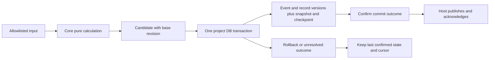

# Phase 2.3 — Storage Architecture & Decision Gates

**2026-10-19 current authorization:** ChatGPT approval, relayed by the user: D-041/D-043 Accepted; D-042 Accepted — conditional architecture; D-044 Accepted — initial implementation policy. Approval selects architecture/policies, not production acceptance. Sequence: **policy approval → restricted implementation → complete acceptance → production enablement**. Only the default-disabled [first Storage slice](../../packages/storage/README.md), on fresh isolated synthetic data, is authorized. Actual Driver-handle/physical namespace binding is unproved: real-project writing stays disabled. Full S01–S13/P01–P08/M01–M04 and O01/O02 remain NOT TESTED as production gates; B1–B7 remain tracked, with hidden loss/replacement/final external races NOT GUARANTEED.

Earlier dated Proposed/no-implementation wording below records historical preparation; this authorization supersedes only its decision status and sequencing, never its safety obligations or evidence limits. No closed Spike is rerun or its result broadened.

**Historical preparation:** Proposed / architecture review pending, 2026-10-08.
**Review follow-up:** direction acknowledged; production implementation not authorized. D-041–D-044 remain Proposed. Every numeric limit, lifetime, ownership and deletion policy below is a proposal awaiting approval/testing.
**Revised Writer direction, 2026-10-09:** the user reports ChatGPT approval of **B + C, retaining A** from the [Writer Safety Review](phase-2.3-writer-safety-review.md): Project-transaction fencing is the durable stale-write boundary; explicit support/failure admission bounds the claim; the independent Owner still coordinates lifetime and normal handoff. The direction is approved, this converged contract remains **Proposed**, and neither production implementation nor Decision acceptance is authorized. Normative must/must-not clauses below specify this proposal, not verified production behavior.
Baseline: `f6d04ad261d2dd4a5d35cd30841697b515405e44`.
Phase 2.2 is archived, compatibility verification **PASS WITH LIMITATION**. D-041 remains **Proposed**. This document defines a design and validation contract; it does not implement Storage or prove recovery.
The narrow Ownership Spike is **CLOSED — PASS WITH LIMITATION**; the [immutable coverage index](../spikes/sqlite-ownership-closure-coverage.md) records its exact scope. Original OP10/P0 CLI exits remain UNVERIFIED. Real release failures remain NOT TESTED; hidden loss, successful replacement and the external Owner Guard–COMMIT race remain NOT GUARANTEED. Full production O01/O02 and all S/P/M gates remain pending.

## 1. Brief, ownership and scope

The goal is reliable local recovery of what APV knows and why, including independent sources and corrections. Preserve Observer, agent-neutral Core, local/private storage, and unavailable rather than fabricated state.

| Owner                  | Responsibility                                                                                                       |
| ---------------------- | -------------------------------------------------------------------------------------------------------------------- |
| Adapter/input boundary | Source-specific parsing, safe normalized fields, stable identity/cursor capability and project attribution           |
| Core                   | Pure domain changes, assertion provenance, future plan/progress/correction/resolution behavior                       |
| Storage                | Strict serialization/reference checks, durable records, transactions, snapshots, schema migration and recovery reads |
| Host                   | Repo-external storage root, identity binding, candidate lifecycle, publish-after-commit and user-authorized deletion |
| Surface                | Display committed data/diagnostics and submit corrections; no SQL or inference policy                                |

Compile dependency stays **Storage → Core**, Host composes both. No `packages/storage`, ORM, event bus, worker service, provider framework, Codex/VS Code implementation or new domain engine is created in this phase.

Phase 1's five input events and current CoreState are the initial contract. Plan events are saved without reconciling hierarchy; `session.ended` does not yet execute correction expiry. Future plan snapshots, Timeline entries and progress records are added only with their Phase 3–6 contracts, in the same commit boundary. No fake progress/Timeline table is introduced to make Phase 2 tests look complete.

## 2. Evidence and specification alignment

Reviewed PRODUCT, ARCHITECTURE, ROADMAP, DECISIONS, TECH_STACK, Phase 2.2 closure/checkpoint/results, acceptance v0.1 and current Core contracts. The archived public digest is [here](../../experiments/phase-2-sqlite-driver-spike/public-evidence/compatibility-summary.json); all original evidence remains private and unchanged.

| Finding                                                                                                                                                      | Classification / disposition                                                                                                                                                                        |
| ------------------------------------------------------------------------------------------------------------------------------------------------------------ | --------------------------------------------------------------------------------------------------------------------------------------------------------------------------------------------------- |
| Historical finding before the §9 revision: ARCHITECTURE suggested generating sourceEventId from cursor when unavailable; Core permits absent identity and a cursor can represent multiple events | **Identity specification BLOCKER resolved:** the approved minimal [ARCHITECTURE §9](../../ARCHITECTURE.md#9-normalized-event-model) revision now preserves optional sourceIdentity and separates EventId/stable sourceEventId from multi-event Cursor. This historical finding is retained; missing-identity/multi-event-Cursor verification preparation may proceed. Corresponding Storage implementation/recovery remains NOT TESTED; D-042 remains Proposed |
| ARCHITECTURE §20 and v0.1 Mandatory Privacy Gates say verification/policy before Phase 2; ROADMAP places the gates within Phase 2 before selection           | **Timing specification resolved, 2026-10-19:** explicit approval separates accepted policy, default-disabled restricted implementation, complete acceptance and production enablement; privacy admission still precedes any real capture. This does not remove independent binding/Host/failure gates    |
| PRODUCT §33 / ARCHITECTURE §20 still called all driver packaging unverified                                                                                  | **Specification status corrected only:** defined compatibility is complete with limitations; production recovery/platform coverage is still pending                                                 |
| Core acceptedEvents is the replay/dedup ledger; cursor-only sources are not deduplicated across new internal IDs                                             | **BLOCKER to journal pruning:** retain the complete applied-event ledger; no retention shortcut or claimed exactly-once                                                                             |
| Core package version is 0.0.0; no durable schema/cursor contract or runtime input decoder exists                                                             | **SHOULD FIX before production:** explicit contract/processor fingerprints and validated boundary are required; package version alone is insufficient                                               |
| Correction/ResolvedConclusion are data contracts; InterpretationState/TimelineReference are not generated engines or full Timeline records                   | **CAN DEFER behavior to their Roadmap phases:** persist references/fixtures honestly; do not implement engines in Storage                                                                           |

The source-identity and gate-timing issues above are presented for architecture approval, not treated as resolved Accepted changes. Design-only work can proceed; related implementation stays stopped.

## 3. Options and preferred shape

| Option                                                                        | Benefit                                                                                         | Rejection/trade-off                                                                                                     |
| ----------------------------------------------------------------------------- | ----------------------------------------------------------------------------------------------- | ----------------------------------------------------------------------------------------------------------------------- |
| **A. Versioned minimal records + normalized journal + snapshots/checkpoints** | Preserves provenance/correction history, supports cache reconstruction, fits current plain data | Preferred; JSON boundary/reference validation and record growth need tests                                              |
| B. A single latest CoreState blob                                             | Small first implementation                                                                      | Cannot be the only durable truth; cache corruption/history deletion would lose explanation and recovery authority       |
| C. Full event-sourced aggregate framework                                     | General rebuild machinery                                                                       | Premature; user corrections/bootstrap are not all Core input events, and future rule changes cannot be blindly replayed |

Option A uses a closed set of current Core records, not a generic record/plugin framework. Fields below are proposed physical storage fields, not new Core IDs or final SQL DDL.

## 4. Storage unit and location

One project/generation per SQLite database, plus a small installation catalog for locating stores and durable deletion intents.

Initial Host policy uses one **project-scoped CoreState** per store generation. A candidate containing several Projects or foreign entity ownership is rejected; Storage never silently filters/splits the arrays. The public CoreState type is unchanged. Cross-project aggregation/shared-session coordination is outside initial persistence support and requires its own reviewed contract.

Proposed Windows baseline root: Host supplies a validated **local** `%LOCALAPPDATA%\AIProjectVisualizer\v1\` root. Core never reads environment variables or resolves paths. Under it:

```text
catalog.sqlite
projects/<random-store-key>/<generation>/project.sqlite
projects/<random-store-key>/<generation>/project.sqlite-wal
projects/<random-store-key>/<generation>/project.sqlite-shm
projects/<random-store-key>/<generation>/migration-backup.sqlite  (only when needed)
ownership/<random-store-key>/owner.sqlite  (proposed lifetime ownership lock)
```

The store key/generation are storage metadata, independently allocated; no root path, Workspace object or external thread identity becomes ProjectId. Catalog binds a canonical local root locator to independently allocated ProjectId/store key/generation. Paths are private metadata, never default logs/export or public evidence.

Initial scope is one known local Windows root per Project. Unknown project attribution is rejected; moving/renaming a repo or ambiguous symlink/worktree mapping is not merged by name. Multi-root/remote/network/cloud-synced storage is not implicitly supported. Validate the final resolved storage path lies outside all supplied repo roots and within the private app root; reject unexpected reparse points/UNC/shared locations and unreadable ownership information. Recheck before deletion. These filesystem protections need real Windows tests, not string-prefix assertions alone.

Catalog has versioned metadata and project bindings with `creating / active / delete_pending / deleted` lifecycle. It stores no events/assertions. Catalog and project database are **not** a cross-database atomic transaction:

- A short catalog transaction uniquely binds the reviewed canonical root locator to one stable store key before any ownership file opens. Competing first-open windows reuse the winning binding; they cannot allocate two lock files for the same binding. Canonicalization/case/reparse ambiguity must be resolved or rejected, not guessed. Initial scope is one reviewed app root/catalog for the OS user, not arbitrary alternate profiles claiming shared ownership.
- Initialization records a creating binding, initializes a matching project/generation with a durable bootstrap, then activates the binding. Interrupted creating records are reconciled or reported; never infer success from a file existing.
- Missing/corrupt DB for an existing active binding is a recovery failure, not permission to create an empty project.
- Deletion is the explicit resumable protocol in §10. No ATTACH-based claim of atomicity across WAL databases.

### 4.1. Binding and physical-resource admission — normative Proposed

The catalog must bind independently allocated ProjectId and StoreKey to one approved observation-root identity/locator and one active generation. Every supported window/profile must use the same authoritative catalog and stable Owner incarnation. A canonical-path string, copied marker, Git remote/title, PID or timestamp must not establish logical or physical uniqueness. Concurrent first-open lookup/creation must converge or reject before either contender obtains business permission; an ambiguous entry must not allocate a competing StoreKey/ProjectId.

Host admission must establish the intended Owner file, Project file **and common WAL/SHM/journal coordination namespace**. Equal main-file identity alone is insufficient. Paths must resolve within the private local root and outside user repositories, under the reviewed volume/access policy. Windows case semantics must be checked; global lowercasing is not an equivalence proof. Unknown identity/access, changed incarnation, foreign marker/generation or unexplained missing active-bound files must return unavailable/conflict, not recreate, merge or select another path.

Proposed initial support is a fixed local NTFS volume with the reviewed Windows x64/Host tuple, no synchronized/network/removable/unsupported virtualized storage. Private database paths must have no unexpected Junction/Symlink/reparse routing or Hard Link/alternate-filename deployment. A project-root alias may reuse a binding only if the approved identity method establishes equivalence; otherwise reject that entrance. Copies/worktrees/moves must not be merged by name or contents. All connections must open the one admitted database path and sidecar namespace; no window-specific Owner or automatic relocation is permitted.

Owner remains stable across generation deletion/resume. Unexpected move/rename/replacement/recreation of Owner or Project revokes permission once detected; known handles drain/close safely and the original authority is preserved. Sanctioned generation replacement must follow the existing maintenance/deletion intent, retirement and closed-data-handle rules while retaining Owner. Restart must reconfirm catalog/root/incarnations/lifecycle and obtain the actual Owner before recovering/fencing. A saved token or unchanged path cannot revive an old instance.

The practical metadata-to-SQLite-open/lifetime binding method is still a **C-class/P0 blocker (§12)**. Candidate Windows handle identity is documented in the Writer Safety Review, but APV integration is UNVERIFIED; fixture dev/ino/birth checks do not attest the actual Driver handle or eliminate TOCTOU. No new native binding is selected. Unsupported mutation policy does not prove mutation impossible on an otherwise supported machine; successful replacement/hidden loss remains NOT GUARANTEED, pending an acceptable failure boundary or stronger architecture. Runtime label meanings/admission are authoritative in [Support Contract §§1–2](phase-2.3-support-and-failure-contract.md).

## 5. Minimum durable structures

Each JSON body has a closed schema, UTF-8 canonical serialization, schema/contract version and digest. Digests detect accidental mismatch, not malicious tampering by the same OS user.

| Structure                  | Key / minimum content                                                                                                                                                                                | Authority                                                                   |
| -------------------------- | ---------------------------------------------------------------------------------------------------------------------------------------------------------------------------------------------------- | --------------------------------------------------------------------------- |
| store_meta                 | ProjectId, generation, lifecycle, schema version, head ledgerSequence, head state digest, producer/format fingerprints, writerEpoch/ownerToken                                                       | Commit/identity/fencing control                                             |
| commits                    | Contiguous project-generation ledgerSequence (the existing proposed revision), base sequence, unique operationId, input kind/ref, before/result/candidate digests, recordedAt, processor fingerprint | Durable operation receipt; resolves lost ACK/uncertain outcomes             |
| normalized_events          | Internal EventId, committed ledgerSequence/ordinal, exact allowlisted NormalizedEvent body, sourceId, optional stable source_event key, identity kind, claim digest                                  | Original normalized observations and complete acceptedEvents ledger         |
| entity_versions            | Closed kind Project/Phase/Task/Session, internal ID, revision, array ordinal, body or explicit removal marker                                                                                        | Recorded Core-produced entity images; keep prior topology/title versions    |
| assertions                 | AssertionId, recorded revision/ordinal, original typed body/digest                                                                                                                                   | Immutable source/inference/user claims; never promote provenance            |
| correction_versions        | CorrectionId + revision, exact CorrectionRecord including lifecycle/supersession/expiry basis                                                                                                        | Append-only correction history; current view selects last committed version |
| conclusion_versions        | Target + typed targetId + revision, reference-only ResolvedConclusion or removal marker, ordinal                                                                                                     | Recorded derived explanation; originals remain separate                     |
| snapshots                  | snapshotWatermark, generation, format/processor fingerprints, current seven CoreState collections excluding acceptedEvents, source checkpoint vector as of that watermark, digest                    | Validated reconstruction cache, not unique truth                            |
| source_checkpoint_versions | SourceId + namespaced stream key + ledgerSequence, exact opaque sourceCursor/codec, complete-unit coverage including canonical accepted input references                                             | Last complete source-consumption unit, not event identity                   |

No plan/progress/Timeline production tables yet. Plan revision/completeness/source references remain on normalized plan events. Structural equality/order preservation is serialization work; deciding plan matching, precedence or correction expiry remains Core behavior.

Storage uses current CoreState collections: projects, phases, tasks, sessions, assertions, resolvedConclusions, corrections, acceptedEvents. Snapshot omission of acceptedEvents is a **storage format detail**: restore rehydrates the full accepted-event ledger up to the snapshot cut. It never returns a truncated ledger to current Core.

Bootstrap is an explicitly trusted complete initial data commit, not evidence that capture already happened. If a trusted initial state has acceptedEvents, validate and store every canonical accepted event/key in that same bootstrap cut; do not omit its ledger or infer source checkpoint coverage from the imported array. Persist initial assertions/correction/conclusion/entity records with their original references. An unsupported/contradictory seed is rejected, not repaired into synthetic history.

Assertions are immutable. CorrectionRecord lifecycle changes are new persisted versions, not destructive rewrites. Snapshot/current correction view may show the last version, while all versions and original assertions remain. Selected/supporting/conflicting assertion references retain target consistency and provenance. When an entity leaves a current collection, a versioned removal marker preserves the prior record; source/correction history is not cascaded away.

SQL keys/foreign keys enforce relational columns, and a typed decoder validates JSON target/value associations, graph ownership, array order/references, finite values and namespace consistency. A SQL foreign key cannot prove references inside JSON arrays. Known sources may have omitted occurredAt; no timestamp is synthesized as source truth.

## 6. Atomic candidate and transaction



Proposed input to Storage: project/generation, expectedHeadRevision, stable operationId, before-state digest, the Core-produced afterState/result, optional normalized input and optional **expected/next complete** source checkpoint. These are a review-level contract; no TypeScript interface/helper is created now.

The review terminology below defines head revision as **ledgerSequence**; it is one field/ordering, not a second counter. A candidate also carries its acquired writerEpoch/ownerToken. Reject a stale generation, owner token or base before accepting it.

operationId is a storage operation token retained across retry, not an external ID or new Core EventId. Assertions/Core state originate from Core or an explicitly trusted bootstrap fixture; Storage only validates and records them.

Its stable candidate digest covers the original domain input/expected base/result/coverage intent, but excludes the transient writerEpoch/ownerToken and retry diagnostics. A new owner retries with its **new** capability while preserving the original operation intent/digest. The original receipt's execution epoch remains audit metadata; it is not the retry's authority. Rebased/new domain intent needs a new operationId, never rewriting an old receipt.

For one applied transition, a single project DB transaction contains:

1. While holding the lifetime ownership connection described in §6.1, **successfully obtain BEGIN IMMEDIATE on the bound physical Project DB**. Only then read that transaction's current persisted Project/generation/lifecycle/writerEpoch/ownerToken and compare the presented private capability. Do not authorize from a transaction-external cache, old read snapshot or remembered connection flag. A mismatch rejects the entire transaction. Look up operationId after valid capability admission but **before original-base rejection**: a matching valid receipt resolves that committed intent, a different stable candidate digest conflicts. Neither a receipt nor copying the current token grants a stale instance permission.
2. For a new operation, compare expected head/before-state digest, enforce event identity/content rules in §7, and validate all records/references and admission limits.
3. Record commit receipt, accepted event, new assertions and versions of affected entities/corrections/conclusions. The receipt stores its execution epoch; it does not turn that epoch into a Core identity.
4. Save the covered source checkpoint version. When generating a snapshot, save its body, digest, checkpoint vector and snapshotWatermark at this exact cut in the same transaction. If no cache is generated, leave the earlier snapshot at its original watermark; never relabel its body/vector as current.
5. Compare-and-swap head revision/state digest with Project/generation/epoch/token/expected-base conditions; require the expected affected row count. Recheck the transaction's resulting control/head invariants and the private Owner lifecycle immediately before COMMIT. No yield/reentrant close may intervene. A failed capability check, row count or final guard must **ROLLBACK all tentative records, dedup and cursor changes**, including DML already executed; a failed CAS must not be followed by COMMIT.
6. Only after confirmed commit and validated current Writer lifecycle/coverage may Host publish the committed current cut and acknowledge the covered source input. An old matching receipt proves that operation, not permission to replace current head with its historical state. Unknown outcome follows §8; no publication/ACK on rejection or unresolved outcome.

Failure at any point cannot leave only an event, only state, or only an advanced cursor. No async callback/network operation runs inside the transaction. Use a managed immediate transaction or raw BEGIN/ROLLBACK consistently, never mix them. A rejected input produces no domain commit/checkpoint advance; report a sanitized error and pause this input stream, without controlling the Agent.

Database reader obtains head/records/snapshot/checkpoint in one read transaction. Project-local commit revisions are ordering for database recovery, not global source event order or precedence.

For the proposed local durability mode use WAL, synchronous=FULL, foreign_keys=ON and bounded busy_timeout=250 ms, read back the settings. At most one bounded **business** BUSY retry is allowed only after proven rollback/not-committed outcome, valid Owner and unchanged operation identity/intent/base; rerun BEGIN and in-transaction admission. No blind COMMIT replay, revision-conflict retry, or automatic revival/retry of a failed fencing instance. Fencing BUSY/error retires that instance; safe data/Owner closure and a fresh actual acquisition are required. The separate proposed 5 s control observation budget is not a lease or hard cancellation of a synchronous native call. These settings/latency bounds are **proposed, not benchmarked**, and require Host evidence. Long read transactions must end so WAL can checkpoint. No journal_mode OFF/NORMAL shortcut to call faults passing.

SQLite documents one simultaneous writer and IMMEDIATE acquisition; WAL/FULL address durability with underlying filesystem assumptions. These facts do not validate APV's transaction bundle or power-loss behavior. [SQLite transactions](https://www.sqlite.org/lang_transaction.html), [WAL](https://www.sqlite.org/wal.html), [synchronous](https://www.sqlite.org/pragma.html#pragma_synchronous), [Driver transaction caveats](https://github.com/WiseLibs/better-sqlite3/blob/v13.0.3/docs/api.md#transactionfunction---function).

### 6.1. Writer coordination and persistence authority — revised Proposed contract

The comparison below retains the original physical choice. The approved B+C+A direction separates its responsibilities:

| Resource / boundary                   | Mandatory responsibility                                                                                                                                 | Does not grant or guarantee                                                                                        |
| ------------------------------------- | -------------------------------------------------------------------------------------------------------------------------------------------------------- | ------------------------------------------------------------------------------------------------------------------ |
| Independent Owner DB                  | Actual same-resource acquisition, contention, normal handoff, intake/maintenance lifecycle exclusion and Project-before-Owner release                    | Owner BEGIN alone grants no business authority; open/inTransaction is not hidden native-lock attestation           |
| Project DB                            | Durable generation/epoch/token, checked capability inside its write transaction, complete atomic bundle, dedup/operation receipts and recovery authority | Not logical binding by itself, immediate revocation on hidden Owner loss, or atomic external publication/ACK       |
| Supported environment / failure model | Admit a reviewed stable-resource/cooperative deployment; reject detectable unsupported or unproved admission                                             | An excluded fault is not physically impossible or automatically detectable; C-class blockers remain until reviewed |

There is no atomic transaction between Owner and Project files (or catalog). The two-file choice is retained; no new synchronization framework or Driver switch is introduced.

| Implementable option                                                                        | Mechanism / crash takeover                                                                                                                                                                                                    | Main cost and risk                                                                                                                                                                                                       | Disposition                                                                                                 |
| ------------------------------------------------------------------------------------------- | ----------------------------------------------------------------------------------------------------------------------------------------------------------------------------------------------------------------------------- | ------------------------------------------------------------------------------------------------------------------------------------------------------------------------------------------------------------------------ | ----------------------------------------------------------------------------------------------------------- |
| **A. Dedicated SQLite ownership database + lifetime IMMEDIATE transaction + project epoch** | One connection holds a write transaction on a small owner.sqlite for the entire ownership interval; contenders cannot acquire that transaction. A new owner must actually acquire the lock, then recover/fence the project DB | Extra connection/file and careful lifetime handling; losing/closing the owner connection must immediately disable the data writer. Local filesystem/file identity must stay stable; a hung owner is not forcibly expired | **Unique recommendation, Proposed**; reuses the candidate Driver, adds no native synchronization binding    |
| B. Windows named kernel Mutex + project epoch                                               | Open one reviewed per-user/project name, acquire on the same OS thread that owns/writes the project; normal release or abandoned ownership permits recovery/takeover                                                          | Requires a trustworthy Win32 binding and thread/lifetime integration in Node/Extension Host; Windows/session/name/ACL scope must be reviewed. Abandoned mutex means inspect DB, not assume clean state                   | Feasible Windows alternative; do not use a free-running helper that can die while its Node writer continues |

SQLite provides cross-process transaction locks and IMMEDIATE exclusion; Windows named Mutex is thread-owned and exposes abandoned acquisition. These official primitives support the comparison, not an APV implementation PASS. [SQLite lock model](https://www.sqlite.org/lockingv3.html), [transactions](https://www.sqlite.org/lang_transaction.html), [Windows Mutex](https://learn.microsoft.com/en-us/windows/win32/sync/mutex-objects).

Why A: the owner database has **no domain writes while ownership is held** and is separate from short project transactions. It is an intentional, tiny lock resource, not a long transaction on project data. The Driver warns against long transactions/event-loop spans generally; this narrow exception requires explicit review and lifetime/crash evidence. It is not implemented via an async `.transaction()` callback. [Driver lifetime/transaction caveats](https://github.com/WiseLibs/better-sqlite3/blob/v13.0.3/docs/api.md#transactionfunction---function).

Proposed ownership protocol:

1. The catalog resolves one stable store key for a Project. All windows/generations use the **same** private ownership file identity, outside the generation directory; no window-specific path. Validate its marker/schema and local canonical path. Initialize the constant marker/schema transactionally; concurrent creation must agree or stop. A missing owner file for an existing binding is an anomaly, not permission to recreate it. A new binding's interrupted creation is explicitly reconciled.
2. Open a dedicated non-pooled connection, verify rollback journal mode DELETE, and issue raw BEGIN IMMEDIATE with proposed busy_timeout=250 ms. Hold that transaction until ownership release; no COMMIT/ROLLBACK, DML, checkpoint, async callback, periodic renewal or maintenance runs on that connection in between. Failed acquisition returns owner_conflict/read-only; it is not a Driver failure. A retry requires another bounded acquisition attempt, never a PID check or lease timeout takeover.
3. Owner acquisition is **HELD_UNFENCED**. With that actual lock held, validate binding/generation/lifecycle and recover a provably complete Project cut. In **the same bound Project DB**, obtain BEGIN IMMEDIATE, read current control state, validate its generation/lifecycle/prior epoch, and conditionally persist e+1 with a fresh opaque token/nonce; require one affected control row and final Owner guard before COMMIT. Confirm the committed control cut before ACTIVE or intake. A new creating store follows §6.3's explicit control/bootstrap boundary; an existing active-bound missing DB is never initialized as new. Fencing-only commits change no domain state, ledgerSequence or sourceCursor. Uncertain control COMMIT disables ingestion; reconcile on a fresh healthy connection only after suspect work is settled (§8), never enter ACTIVE from an uncertain return. Fresh reacquisition must increment the persisted epoch, without wrap/reuse.
4. Every candidate is bound to Project/generation/epoch/token/base. Apply §6's **transaction-internal Project capability guard** after actual write acquisition and before domain writes, through conditional head update and COMMIT. Separately check the private Owner acquisition/lifecycle before entry and immediately before COMMIT. Observable loss rolls back the complete Project transaction, including control writes. No await/user hook/reentrant close may occur between that final Owner guard and COMMIT; both connections remain on one serialized execution thread, with no shared worker handles or independent helper. This mitigates controlled release/loss, not invisible external changes. `inTransaction` alone is not a physical-lock test and cannot replace the Project guard.
5. Normal exit first disables intake/publication/ACK, drains or cancels pending work and reconciles uncertain commits, invalidates candidate capability, finishes/closes the Project writer, then rolls back/closes Owner. Once release starts, cached candidates must never use the old capability. If the Project transaction/handle cannot be proven unable to commit later, do not intentionally release Owner; remain blocked/unavailable. If Owner close/release fails or is unclear, do not assert either retained lock or successful CLOSED; preserve the disabled instance and sanitized evidence. Only reviewed idempotent cleanup may retry, without business permission. Do not delete the lock file or use PID/heartbeat/timeout to force release.
6. A process crash releases its OS-managed connections/locks under the supported filesystem assumptions. A contender proves availability by successful BEGIN IMMEDIATE, validates/reconstructs the project, increments epoch and reopens intake. Crash between acquisition/recovery/epoch steps produces no accepted input or advanced cursor. A still-running or suspended owner keeps ownership; no availability promise or forced process termination is made.
7. On unexpected owner connection closure, transaction loss or owner error, permanently disable that ownership instance before another data operation; no automatic reconnect using the old token. A contender acquiring the owner lock and increasing epoch makes every old candidate stale. Epoch/CAS protect cooperative stale work; they do not secure the DB against arbitrary same-user programs bypassing the protocol.

The lock resource is scoped to the stable Project binding across generations; the persisted fencing token is scoped to a particular project DB/generation. This also serializes deletion/resume/maintenance. Any short catalog mutation rechecks the binding version/lifecycle; never hold a catalog transaction while waiting for ownership. Readers need no ownership lock, but read one consistent project cut and honor pending/deleted bindings.

PID and creation time may appear in **transient private diagnostics** only; neither is ownership authority. PID reuse, stale metadata and a missing process-list entry cannot authorize takeover. File removal/replacement/rename while participants can open it can split lock identity; ordinary deletion retains the minimal owner file/marker, never resets it or ignores corruption. Unsupported filesystem locking/permissions, unexpected identity or a foreign holder stops acquisition. [SQLite file-identity/locking hazards](https://www.sqlite.org/howtocorrupt.html).

Ownership contention and Project SQLITE_BUSY are separate: a losing window remains conflicted/read-only without intake; a fenced owner uses only §6's bounded proven-not-committed business retry and otherwise pauses without ACK. A hang/release anomaly permits no time-based takeover. Owner acquisition → recovery → confirmed Project fencing → ACTIVE → individually guarded business COMMIT → lifecycle/coverage-validated publication/ACK → intake revocation/data closure → Owner release is the authorization order. Production enforcement remains **NOT TESTED**, despite the closed component Spike; full O01/O02 and scope approval remain gates.

**Conditional safety separation:** on one unchanged Project DB/generation and common journal/locking domain, with reliable SQLite write serialization and every write obeying §6, a new fencing COMMIT cannot be followed by a legal old-epoch business COMMIT. If old data holds the write transaction first, fencing must wait until it ends; if fencing commits first, the later old transaction reads mismatch and rolls back. This is a conditional ordering argument, not a production proof. Owner normal coordination adds lifetime single-Writer behavior only with one binding, actual exclusion and private capabilities. Neither argument guarantees no old COMMIT immediately after hidden Owner loss: B can own Owner while still blocked from Project fencing. Hidden Project locking/resource failure invalidates the same-DB argument itself.

**Pre-execution review gap:** an old Writer can hold the Project transaction after releasing Owner; the new owner then cannot increment epoch until that transaction ends. Without the final live-Owner guard, the old epoch can still commit after loss. The [Ownership Spike design](../spikes/sqlite-ownership-protocol.md) now specifies OP06's guarded rollback plus unsafe baseline counterexample, full ownership state machine and epoch timing. The two-file proposal does **not** guarantee instantaneous revocation or detect hidden kernel/VFS lock loss/file replacement between guard and COMMIT. Cooperative private lifecycle, stable file identity and their supported failure scope remain explicit approval/evidence requirements; they are not waived by passing fixture tests. Conditional direction approval does not authorize this probe or production implementation.
That paragraph describes the historical design gap. The component probe has since closed within its recorded scope; the unsafe counterexample and production gap remain. Strong instantaneous revocation under invisible loss or successful replacement is still **ARCHITECTURAL BLOCKER** if required within production support; B+C+A approval does not resolve it by assumption.

### 6.2. Exact commit bundle and external publication

For every accepted input, one ledger commit contains the canonical NormalizedEvent (or a reference to the existing canonical duplicate), its dedup claim, new Assertions and their exact source/event references, affected entity/conclusion/correction version images, any supported plan-history changes, any **actually generated and persisted** derived Timeline changes, expected/next covered sourceCursor and operation receipt/head digest. A generated Snapshot includes its corresponding watermark/vector in this same commit. Missing one required effect is an input rejection/rollback, not a partial success.

At the current phase plan history is the exact normalized plan inputs/source revisions, correction changes are explicitly trusted fixture record versions, and there is no Timeline Engine or Timeline payload/table. Later Phase 3/5/6 schema/contracts must add their actual outputs to this same all-or-nothing bundle before accepting inputs requiring them. Storage cannot silently omit unsupported effects or manufacture derived Timeline/progress to satisfy this list. Reference checks cover original assertions/sources and correction lifecycle basis as well as projected state.

COMMIT return/verified operation receipt is the durability boundary. Before it, candidates are private pending data: neither confirmed state/Timeline nor source-consumption completion can be published. After it, Host publishes the identified committed cut. External acknowledgment is **outside SQLite**, so a crash after COMMIT but before ACK causes source retry. Confirm the stored operation/identity/body/coverage and then ACK again without new effects. A retry resolved to an older committed receipt proves that operation, not that its historical state should replace the current head; publish only the verified current cut. If identity is unavailable, retries with new internal IDs can repeat; this is a declared limitation, not exactly-once delivery. No new outbox/network framework is proposed.

### 6.3. Complete write-path coverage — no unguarded production DML

| Path                                                                                                                             | Required authority and transaction boundary                                                                                                                                                                                                                                                                                                                                                                                                                                                                                                                                                                                                                                                                                                                                         |
| -------------------------------------------------------------------------------------------------------------------------------- | ----------------------------------------------------------------------------------------------------------------------------------------------------------------------------------------------------------------------------------------------------------------------------------------------------------------------------------------------------------------------------------------------------------------------------------------------------------------------------------------------------------------------------------------------------------------------------------------------------------------------------------------------------------------------------------------------------------------------------------------------------------------------------------- |
| Business input, checkpoint-only receipt, dedup claims/coverage, actually generated Snapshot/History/Correction/Timeline versions | §6 Project BEGIN + current persisted generation/epoch/token guard, whole applicable bundle and final checks. A duplicate with a new cursor position is a guarded atomic checkpoint commit, not an unfenced update                                                                                                                                                                                                                                                                                                                                                                                                                                                                                                                                                                   |
| Fencing control                                                                                                                  | Actual Owner held; same Project BEGIN; current generation/lifecycle/prior epoch checked, conditional e+1/new nonce and final Owner check; no domain/head/cursor/ACK effects; uncertain outcome blocks ACTIVE                                                                                                                                                                                                                                                                                                                                                                                                                                                                                                                                                                        |
| New creating binding/bootstrap                                                                                                   | Only a durable authorized creating catalog entry and actual Owner permit initial schema/control creation under Project BEGIN. Establish known generation/e0 control metadata without domain data; confirm fresh fencing, then write the complete trusted bootstrap through the same in-transaction capability guard while admitting only that creating lifecycle. Transition the Project lifecycle to active in that complete bootstrap commit; keep intake/publication paused until its verified result and separate catalog activation. A creating control-only DB is not a successfully restored empty CoreState; interrupted creation reconciles exact existing metadata/bootstrap intent or is unavailable, never overwrites a completed seed or initializes an active binding |
| Migration, SQL retention/cache cleanup, persistent recovery/cache repair                                                         | Stop or serialize intake under the same Owner/current capability; every APV Project mutation uses checked Project BEGIN/current control state. Migration preserves the fencing row and capability/generation history; validate supported old/new format and full cut before success. SQL cache deletion cannot prune authority or advance cursor. Reads alone need a consistent cut, not write permission                                                                                                                                                                                                                                                                                                                                                                           |
| Deletion, generation retirement/resume                                                                                           | Hold the same stable Owner; check current capability/generation in the transaction durably retiring old data. Drain/close Project handles before managed filesystem removal/replacement. New generation uses the authorized creating/bootstrap path; old token/generation never revives. Catalog intents/completion are separate checked lifecycle transactions, not a cross-file atomic bundle                                                                                                                                                                                                                                                                                                                                                                                     |
| SQLite physical maintenance / backup                                                                                             | Automatic journal recovery/checkpoint is SQLite/VFS behavior within the admitted resource assumptions, not an APV unfenced domain write. Deliberate checkpoint/backup or managed file cleanup uses a drained or serialized maintenance phase with actual Owner and freshly validated Project control/identity. Operations that cannot run inside Project BEGIN may not mutate APV logical records/head/cursor or substitute for a guarded commit; preserve the whole database/sidecar cut. Unsupported native lifecycle/outcome stays blocked                                                                                                                                                                                                                                       |

Catalog and constant Owner-marker initialization do not use a fictitious Project epoch: they have their own short identity/lifecycle-checked transactions, and never confer business authority. Their exact schema/creation/maintenance implementations require the existing O01/P03/P07/P08/M gates. Project DDL/control exceptions above are closed, explicit paths; new PRAGMA/raw SQL/file replacement routes must be reviewed, not admitted as generic maintenance. No production path may read a token outside its write transaction and later rely on it as an authorization result.

## 7. Identity, duplicates, order and checkpoints

### 7.1. Four distinct identities/positions

All fields below are storage/source metadata proposals, not added Core types. sourceSequence and Core EventId remain separate.

| Term                         | Scope / uniqueness                                                                                                               | Creation and update                                                                                                                                                                                                                                                            | Durable location                                                                                                                        |
| ---------------------------- | -------------------------------------------------------------------------------------------------------------------------------- | ------------------------------------------------------------------------------------------------------------------------------------------------------------------------------------------------------------------------------------------------------------------------------ | --------------------------------------------------------------------------------------------------------------------------------------- |
| **sourceId + sourceEventId** | Real source event uniqueness namespace within a Project generation; not across every Source or generation                        | Source supplies a stable event ID, or Adapter has independently verified event-specific identity. Claim is immutable; retries compare content. Missing stays missing, never synthesized from a batch cursor/title/time                                                         | Canonical normalized_events body and partial unique source-event key/claim digest                                                       |
| **sourceCursor**             | SourceId + neutral stream + codec + generation; opaque resume/consumption position, not necessarily unique per event or sortable | Source/Adapter supplies position with verified consumption-unit coverage. Replace only from matching expected checkpoint after complete covered inputs commit; absence is allowed for non-resumable sources                                                                    | source_checkpoint_versions and its exact covered canonical references/ledger cut; snapshot vector records the value as of its watermark |
| **ledgerSequence**           | Contiguous positive safe integer 1..H per Project generation; unique **commit**, not source event                                | Allocate head+1 inside successful event/bootstrap/checkpoint-only commit; rollback consumes no sequence. Event ordinal distinguishes multiple bootstrap entries. No increment for rejected/exact no-op duplicate or owner-only control transaction; never rewrite old sequence | commits primary key; store_meta head; record/event/checkpoint versions reference it                                                     |
| **snapshotWatermark**        | Project/generation and a committed ledgerSequence S; identifies the exact state/vector represented, not source time              | Assigned when snapshot at S is generated inside that commit, or when a cache at an existing validated cut is rebuilt under ownership. Rebuild changes no domain ledger/cursor; never advance watermark without rebuilding/verifying the full body/vector                       | snapshots row/format/digest and ledger reference; may be S < current head H                                                             |

Every commit links its prior sequence/digest and complete operation contents; restore requires sequences 1..H and valid references. Current acceptedEvents is the ordered canonical applied-event subset (sequence/ordinal), **not** all commit receipts; checkpoint-only and owner control operations must not invent Core events. A trusted bootstrap preserves its existing event array order within its bootstrap sequence.

### 7.2. Retry and degraded source capabilities

| Input                                                  | Rule                                                                                                                                                                 |
| ------------------------------------------------------ | -------------------------------------------------------------------------------------------------------------------------------------------------------------------- |
| Same internal EventId                                  | All persisted event fields must match; matching is a duplicate, changed contents are identity_conflict, never overwrite                                              |
| New internal ID, same stable (SourceId, sourceEventId) | Compare canonical claim fields excluding internal ID/receivedAt; matching reuses the canonical accepted event, not a second assertion; changed claim fields conflict |
| Same cursor/revision on different event IDs            | May be a batch position; do not unique-index or deduplicate as if it identifies one event                                                                            |
| No stable source identity                              | Retain internal IDs for APV's own journal replay; new external-normalization IDs can be accepted again. Report at-least-once limitation, not exactly-once            |
| Same operationId                                       | Same candidate digest resolves to its original outcome; different candidate contents conflict                                                                        |
| Rejected/unavailable source input                      | No cursor advancement or guessed skip; source remains blocked pending explicit resolution                                                                            |

Claim comparison includes project/session/source attribution, type/payload, source identity/sequence, occurredAt when provided and causal references; it preserves strings/array order and does not fuzzy-match titles or times. For stable-source retries only id and receivedAt may differ without conflicting. Original observed/asserted provenance/time remains untouched.

The partial unique index is for actual source_event identity only, scoped by this project store and SourceId namespace. A SourceId must cover the real uniqueness namespace; if source IDs are only session-local, the Adapter must supply a correspondingly scoped SourceId. Storage cannot assume transport-global uniqueness.

Checkpoints use SourceId and a neutral stream key; sourceSequence is source-local metadata, not a global sequence and not automatically the resume cursor. Store an opaque cursor only with its declared format/capability and complete consumption-unit proof. Never order opaque strings lexically. A batch advances only after all items are committed; partial progress requires a separately verified item offset, otherwise stop at the last fully covered batch. The expected prior checkpoint must match. No unhandled gap is crossed by choosing the largest received sequence.

A stable-source duplicate with no checkpoint change needs no new domain revision. If it completes a new verified consumption position, commit a **checkpoint_only** receipt/snapshot cut atomically with unchanged Core state, without adding the alias EventId to Core.acceptedEvents. Core.hasProcessedEvent(alias) remains false, matching current semantics; the source key still recognizes that repeated input.

Persist late claims/cause references without fabricating occurrence time or using arrival order to override current interpretation. Unknown causal references/attribution are reported rather than guessing. Current minimal Core does not resolve status/expire corrections. Future resolution/Timeline behavior is versioned Core output, never a Storage timestamp sort.

No stable source ordering: ledgerSequence records local durable acceptance order only. Do not compare source timestamps/sequences across streams. Persist legitimate late claims as new historical input; a verified independent consumption-unit receipt may advance its own checkpoint, while an old replay position cannot move the current cursor backward. If resume coverage/order cannot be proved, keep the prior cursor (or none), report the limitation and do not ACK beyond the covered unit. Content conflict or an unresolved gap pauses that stream. A matching duplicate may ACK its already covered source unit; a new position requires the checkpoint-only transaction described above.

## 8. Restart, incomplete writes and ambiguous commit

Normal restore:

1. Verify catalog/store generation/lifecycle, application marker, supported DB/snapshot/record versions and processor fingerprint. Existing identity with absent DB is unavailable.
2. Open read transaction at one head H; validate SQLite integrity/relational and typed-reference consistency.
3. Decode a compatible snapshot at S <= H, reconstruct its acceptedEvents through S, and verify its state digest/cursor vector.
4. Restore H using recorded versions and complete journal/cursor records. Rehydrate all Core collections, preserving absent conclusions and correction lifecycle. Never call createCoreState() as a successful recovery fallback.
5. If approved processor replay is used for tail normalized events, start from records <= S, apply only commits after S with original IDs/time, compare each recorded result digest, and never preload future assertions before replay (would collide with deterministic assertion IDs).
6. Bootstrap/correction/non-event transitions use their recorded version images; current Core has no correction input processor. A mismatched processor/version or replay digest stops, rather than interpreting old inputs under new rules.
7. Publish only when state, accepted ledger, head and checkpoint form one consistent cut. A read/corruption failure produces recovery_unavailable/last-known diagnostics, not 0%/todo/completed.

A damaged/missing snapshot cache may be reconstructed from complete authoritative versioned records/journal at H and the recorded state digest, without re-inferring facts. A bad authoritative record/journal cannot be hidden by returning an older snapshot with a newer cursor. If only an older complete cut is provable, label it partial/last-known, halt ingestion and require explicit recovery approval; never claim full restore or silently rewind a source checkpoint.

Process killed before COMMIT: a fresh process must observe the old complete cut. Killed after COMMIT before ACK: it must observe the new complete cut and recognize the same operation/input on retry. COMMIT I/O error or lost connection leaves an **unknown** caller outcome until reconciled: revoke the failed instance's writes/publication/ACK, settle or safely close the suspect Project transaction so it cannot commit later, and retain valid Owner where possible. If settlement cannot be proved, do not intentionally release Owner or infer rollback from a Reader's missing receipt.

Using a **fresh healthy Project connection and one consistent authoritative cut**, validate the same physical resource/generation and operationId + stable intent digest + canonical internal/stable-source event identity and committed coverage. A matching receipt confirms that operation, not its historical state as current. For fencing, match the proposed acquisition nonce (ownerToken), generation and expected epoch against committed control state; a missing/superseded nonce alone cannot prove that earlier control COMMIT failed. This draft adds no new historical fencing-receipt table; where the current control row cannot prove the old outcome, retain unknown rather than invent a successful historical attribution. A fresh owner may establish new authority only after safe settlement and verified current recovery.

Receipt absence means not committed only after suspect work is unable to commit later **and** readable complete authority/identity is verified; unreadable/contradictory evidence stays commit_outcome_unknown/unavailable. Fresh acquisition must actually obtain the same Owner, recover the complete cut and commit a new epoch before any business retry/re-ACK. Preserve operation intent across retries, never reuse the failed token, return an older snapshot as current, or ACK beyond proven committed coverage. No Driver fallback or PID/heartbeat/deadline takeover is allowed.

WAL is part of the database state; do not copy only project.sqlite while live, remove WAL as a cleanup shortcut, or call ordinary close/reopen a process restart. Fault injection proves its stated scope; process termination does not prove OS power-loss behavior. [Atomic commit assumptions](https://www.sqlite.org/atomiccommit.html), [WAL lifecycle](https://www.sqlite.org/wal.html).

### 8.1. Recovery disposition matrix — Proposed, NOT TESTED

| Condition                                                                                                          | Permitted automatic action / current-state result                                                                                                                                                                                                                                         |
| ------------------------------------------------------------------------------------------------------------------ | ----------------------------------------------------------------------------------------------------------------------------------------------------------------------------------------------------------------------------------------------------------------------------------------- |
| Supported valid Snapshot at S, continuous complete ledger through H                                                | Verify watermark/body/digest and source vector at S; hydrate full acceptedEvents through S, restore/replay tail, validate head/vector at H. Publish H only after all checks                                                                                                               |
| Snapshot absent or cache-only corrupt                                                                              | Under acquired ownership, reconstruct H from independently validated authoritative versions/journal/receipts/digest; persistent cache repair waits for confirmed current capability and the checked Project write transaction (§6.3). Rebuild only cache at H, no source rewind/new facts |
| Snapshot version too old                                                                                           | A specifically approved lossless decoder/format migration may decode it; otherwise ignore only that cache and rebuild from supported complete authority. Unknown authority/producer version or incomplete records → unavailable                                                           |
| Ledger sequence/previous digest gap, duplicate sequence, missing event, conflicting duplicate claim                | unavailable; do not invent a skipped event or delete the conflicting authority. A latest blob cannot hide missing provenance/ledger                                                                                                                                                       |
| Snapshot watermark beyond H, mismatched body/digest/vector                                                         | Cache may be rejected/rebuilt only if independently complete authority at H is provable. Never simply change watermark/vector labels                                                                                                                                                      |
| Authoritative Cursor ahead of its covered ledger/events, unexplained backward cursor or wrong namespace/generation | unavailable for that project recovery/current cut; no automatic cursor rewind, state fast-forward or source ACK. A bad snapshot-only cursor vector may be rebuilt from valid authoritative checkpoint records                                                                             |
| COMMIT succeeded, external ACK not sent                                                                            | Recover receipt/state/cursor, match retry identity/body/coverage, ACK that committed unit again. No second canonical effect when stable identity/operation is available                                                                                                                   |
| SQLite recovery resolves an interrupted transaction                                                                | Accept the verified all-old/all-new cut after SQLite and APV reference/digest checks; no assumption from a process exit or successful open alone                                                                                                                                          |
| Authority/database corruption or insufficient provenance/correction history                                        | unavailable; preserve original files and diagnostics. A backup is a separately labeled recovery candidate, never automatic latest-state success                                                                                                                                           |
| Migration interrupted/failed                                                                                       | If SQLite rollback and complete old schema/records/cursor are independently verified, resume the old supported cut after owner recovery. Unknown/mixed result, failed schema decoding or backup-only older cut → unavailable/pending explicit recovery                                    |

An isolated older complete cut may be displayed as explicitly **last-known**, with capture/ACK paused; it is not returned as successful current restoration. Automatic repair is limited to disposable caches or SQLite's proven rollback plus full authority verification. It never removes authoritative history or changes source/provenance/correction claims.

### 8.2. acceptedEvents growth and compression boundary

Current Core requires the full acceptedEvents array and performs linear duplicate lookup/array growth. Minimal disk versioning or two caches does not bound restore-memory/CPU cost. No Core contract change, ledger pruning, ID-only substitute or Bloom-filter dedup is authorized. Track event count, serialized/rehydrated sizes and actual restore latency in the disposable experiment, without inventing performance PASS thresholds; implementation limits need measured acceptance later.

Lossless encoding/index optimization may be proposed only if exact acceptedEvents/order/IDs and all historical references remain reproducible. **Deleting or coalescing authoritative events/assertions/corrections is not allowed in the initial proposal.** Future semantic history compression requires a separately approved Core replay/dedup contract, provenance/correction reference closure, cursor/receipt reconstruction and independent recovery equivalence tests. Neither age, quota pressure nor migration authorizes it. At the proposed cap, intake stops with the old state/cursor intact.

## 9. Privacy allowlist — policy proposal

No storage/log field is accepted merely because it is normalized. Reject unknown fields at ingestion and decoding; do not silently drop fields and pretend a complete original input was accepted.

### 9.1. Field classification and filtering order — Proposed

**A = default allowlisted persistence**; **B = admit only after source-specific validation, minimization/redaction and length limits**; **C = necessary bounded transient processing only**; **D = default prohibition on capture/persistence/logging**. These are Proposed policy categories, not a claim that text can be universally sanitized.

| Field / representation                                                                                                                                 | Category                                                                                                                    | Before SQLite, snapshot, backup or diagnostic sink                                                                                                                                                                                                                                                                                           |
| ------------------------------------------------------------------------------------------------------------------------------------------------------ | --------------------------------------------------------------------------------------------------------------------------- | -------------------------------------------------------------------------------------------------------------------------------------------------------------------------------------------------------------------------------------------------------------------------------------------------------------------------------------------- |
| Internal Project/Phase/Task/Session/Assertion/Event/Source IDs; typed topology, status/certainty/weight, provenance, rule versions and safe timestamps | A                                                                                                                           | Closed schema, target/ownership/finite-value/reference validation; never substitute external path/Agent identity                                                                                                                                                                                                                             |
| Canonical project root in private binding and existing Project.locations; owned store/backup paths                                                     | B                                                                                                                           | Admit only necessary local locator, canonicalize/check root/ownership, bound length; full root stays private. Diagnostics/public fixtures use stable synthetic alias, not basename or username                                                                                                                                               |
| Other file paths, repository tree, file contents/diffs                                                                                                 | C for a specifically necessary observed locator; D for content/tree collection by default                                   | Extract only an approved minimum locator before normalization; no arbitrary path/path arrays or file content in DB/logs                                                                                                                                                                                                                      |
| SourceReference.reference/revision; sourceEventId; sourceCursor; source session/plan locators                                                          | B                                                                                                                           | SourceId namespace + reviewed non-secret source format/codec and byte limit. Reject credential URLs, tokens, command/source blobs; opacity is not a safety exemption. Do not mask/hash an identity or cursor into a new alleged equivalent value without independently reviewed injectivity/resume semantics; reject unsafe identity instead |
| NormalizedEvent envelope/payload                                                                                                                       | A for closed typed fields; B for each included title/locator                                                                | Recursively apply field classifications, including causal IDs and plan steps. Unknown fields or unsafe nested content reject the input, not a silently truncated valid event                                                                                                                                                                 |
| Short necessary task/plan titles, inference/resolution reason/rule strings                                                                             | B                                                                                                                           | Reviewed source extraction + byte/shape/known-secret checks; allow only minimal local text. If redaction is specified, perform it before Core accepts the canonical input; retries compare that same admitted representation. Unsupported/free prose is rejected, never silently rewrite a persisted Assertion                               |
| Full plan prose, prompt/messages, code blocks, raw protocol and command/tool output                                                                    | C only for bounded parsing when formally available/necessary; D for default retention                                       | Extract approved typed fields then release transient buffers; no serialized raw copies or catch-block dumps. No whole-conversation capture default                                                                                                                                                                                           |
| Command executable/arguments, cwd, environment variables                                                                                               | D by default; C only if essential to supported input parsing                                                                | No command execution model exists in the five event vocabulary; do not add a command payload. Never save argv/env/credential-bearing cwd or embed them in an opaque reference                                                                                                                                                                |
| Exception objects, message/stack/cause, SQL text/bound values, driver error paths                                                                      | C                                                                                                                           | Convert to fixed safe error category + approved operation reference before any diagnostic/output; never forward raw Error.message/stack by default                                                                                                                                                                                           |
| Log/diagnostic fields                                                                                                                                  | A for safe error category, bounded opaque operation/run alias and verification status; B for necessary bounded code/version | Default diagnostics transient. No raw object interpolation, input hashes as alleged anonymization, process/env dumps or default persistent debug log                                                                                                                                                                                         |
| PID/process creation time/runtime details for ownership troubleshooting                                                                                | C                                                                                                                           | Private transient diagnosis; not ownership authority or production business record. A separately authorized experiment uses synthetic/allowlisted evidence derivatives                                                                                                                                                                       |
| Access tokens/passwords/private keys/cookies/credential URLs; unrelated personal data                                                                  | D                                                                                                                           | Reject before admission; never log matches. If a source unexpectedly sends it, bounded inspection/drop is incident handling, not permission to retain                                                                                                                                                                                        |

Filtering order: approved source capability → bounded transient parse → field allowlist/minimization → safe typed normalized input → Core candidate → **second strict Storage decoder/admission check** → transaction/snapshot/backup. An independent safe diagnostic projection runs **before every log, exception report or experiment evidence sink**, including rejected input, duplicate conflict, restore, migration and deletion errors. Driver/SQLite cannot be asked to write an unsafe value first and then delete/redact it; WAL/rollback/temp pages could retain it. Invalid input cannot advance sourceCursor.

The initial proposal persists no diagnostic log. If future logging is added, it must use the same allowlisted projection and its own approved retention; turning on troubleshooting is not permission for raw dumps. Real data in allowed titles/paths remains sensitive: known-pattern tests cannot prove removal of every secret, and no universal automatic sanitizer is claimed.

### 9.2. Minimum admitted data and Proposed bounds

| Data                        | Allowed minimum                                                                                          | Excluded / handling                                                                                                              |
| --------------------------- | -------------------------------------------------------------------------------------------------------- | -------------------------------------------------------------------------------------------------------------------------------- |
| Core identity/topology      | Existing internal IDs, names/titles, membership/order, per-field assertion references                    | Agent/Workspace identities substituted for Core IDs                                                                              |
| Project location/catalog    | Canonical local project root locator needed to reopen the binding, private store/generation IDs          | File tree, unrelated local paths, remote URLs with credentials; no default telemetry/export/logging                              |
| Event                       | Existing five types/envelope, safe typed payload, optional namespaced identity/revision/time/causal refs | Raw protocol objects, prompts/messages, commands/stdout/stderr, edits/diffs/source contents                                      |
| Plan                        | Complete/partial flag, necessary short step titles, safe references/revision                             | Full conversation/plan prose, code blocks/tool output; over-budget input is rejected, not truncated into a falsely complete plan |
| Assertion / inference       | Exact target/value/provenance, necessary rule/score/time and evidence refs                               | Naked rewritten status, global confidence, raw inference prompt, invented verification                                           |
| Correction / conclusion     | Scope/IDs/time/lifecycle/rule/reason and referenced original assertions                                  | Blanket global precedence or rewritten source claims                                                                             |
| Source-owned opaque refs    | SourceId namespace plus bounded, documented non-secret event/session/revision locator                    | Bearer tokens, credential URLs, raw file/protocol payload smuggled into opaque strings; unsupported formats are blocked          |
| Diagnostics                 | Stable sanitized error category/operation outcome in memory                                              | Default raw error stacks, SQL bound values, process/env dumps, file paths or persistent debug logs                               |
| Snapshot / migration backup | Same allowlisted content, private app root, same retention/deletion scope                                | Copying unfiltered Core/Adapter objects, cross-project backup roots                                                              |

Proposal limits: UTF-8 title/name <=512 bytes; ordinary IDs <=256 bytes (deterministic AssertionIds <=1024); rule/reason <=512; documented opaque ref <=512; single event <=1 MiB and plan <=4096 steps; snapshot domain body <=8 MiB. Reject unknown enums, non-finite values, invalid positive weights, invalid confidence bounds, unparseable timestamp/reference ownership and oversized records. Limits are not proven performance bounds and require approval/testing.

Necessary plan titles/root locators remain **sensitive local metadata**. Pattern screening cannot prove arbitrary title text contains no private business information; source-specific field admission, local-only handling and review are still necessary. Known credential patterns/unsupported text shapes are rejected without logging the matched text. Storage does not use a cloud/LLM redactor or rely on Semantic ON.

Same-OS-user access, OS backup/sync, SSD/filesystem forensic recovery and credential theft by compromised local software are outside this initial protection claim. OS-private data directory/permission checks are required; no new encryption/keychain product framework is silently introduced.

## 10. Retention, deletion and data isolation — policy proposal

**Every duration, count, quota and deletion policy in this section is Proposed.** User review and executable evidence are required; none is a current product promise.

| Category                                                                                                                                  | Proposed retention / bound                                                                                                                                                                                      |
| ----------------------------------------------------------------------------------------------------------------------------------------- | --------------------------------------------------------------------------------------------------------------------------------------------------------------------------------------------------------------- |
| Raw transport, source/prompt/tool output and diagnostic payload                                                                           | No default persistent retention; only bounded transient parsing                                                                                                                                                 |
| Accepted normalized event/identity ledger, original assertions, entity/correction history, commit receipts and source checkpoint versions | Project generation lifetime, until explicit project-state deletion; logical serialized durable record budget 128 MiB per generation; no age-based silent pruning                                                |
| Snapshot caches                                                                                                                           | Current and previous complete cuts, at most two caches, each <=8 MiB; never delete required journal/records with them                                                                                           |
| Migration backup                                                                                                                          | At most one consistent pre-migration backup, same private scope. After validated migration, remove after 7 days; failed recovery retains that one backup until explicit resolution and blocks another migration |
| Application catalog / revocation marker                                                                                                   | Minimum root-binding/generation/lifecycle metadata, no source content; cleared/replaced only through explicit resume/reset policy                                                                               |
| Stable ownership file/constant marker                                                                                                     | Retained with the minimal binding/revocation marker across generation deletion/resume; no domain payload/process history; never delete/replace while participants can open it                                   |
| Diagnostic logs and parsing scratch                                                                                                       | No persistent default; bounded transient buffers. Owned temporary files are not used for raw data and are removed after success/failed operation once safe ownership is proved                                  |

This is a bounded-capacity history proposal, not an indefinite-history promise or a silently chosen seven-day source retention. The proposed seven-day period applies only to a **successful migration backup**, with the stated failed-recovery exception. Automatic expiry of meaningful source/correction history is **not** proposed.

At record/snapshot limits, reject the whole candidate before ACK, keep last committed state/cursor, mark observation persistence limited and stop intake. Do not increase progress, pretend a record was saved, trim Core.acceptedEvents, delete an active correction or enable unbounded queues. User can later approve capacity/reset choices; no advanced settings/compaction framework is introduced now.

The Proposed 128 MiB logical history budget counts all retained authoritative typed records/receipts/cursor bodies, excluding the separately bounded two snapshot caches. WAL/pages/index/backup/ownership-file overhead is additional; proposed per-project physical high-water 512 MiB includes these artifacts and causes admission to stop. It is an early warning/stop threshold, not a provable exact filesystem cap: transaction overhead, long readers and disk failure require tests. Do not delete WAL/only recovery backup to get below the limit. Catalog needs a separately bounded installation budget before production; proposed 8 MiB logical installation metadata includes catalog/revocation and constant ownership markers, stops new bindings rather than dropping those markers.

Quota checks include the complete next bundle before domain writes; a real SQLITE_FULL during writes/COMMIT still follows rollback/unknown-outcome reconciliation. No event may be omitted while its cursor is committed. With no capacity for a checkpoint-only receipt, keep the old cursor too. Already committed, verified-covered input can be re-ACKed without a new write; that does not permit acknowledging a new consumption position. SQLite page/WAL/temp and backup overhead cannot be predicted exactly, so a space precheck is not a durability proof. Lack of space to record deletion/migration control intent blocks that operation rather than falsely reporting completion.

Explicit project-state deletion is a resumable operation, not a cascade inside a normal event commit:

1. Validate explicit user intent, exact ProjectId/generation and root ownership; record catalog delete_pending durably. Host stops new intake/publication for that binding.
2. Obtain the stable Project ownership lock (existing owner drains/releases cooperatively; no forced takeover), recover/fence to a confirmed current capability, then acquire the checked Project write transaction to validate current generation/epoch/token and durably mark that generation deleting, rejecting all later ordinary candidates. An earlier transaction may finish before this retirement, but its data is still within deletion scope. Hold ownership through removal and catalog completion; a separately validated delete_pending/deleting continuation follows §6.3's maintenance path rather than reviving ordinary ACTIVE intake.
3. Close owned **project data** handles and request participating readers to release only this store; retain the dedicated owner connection/lock. Do not terminate processes. If ownership/handles cannot be established, deletion is blocked/pending; never release ownership then race a new store opener while removing files.
4. Remove only verified owned project DB/WAL/SHM, snapshots, migration backup and corresponding APV caches/temp artifacts. Check every target stays in that store root; never recurse into a repo or SourceId-derived path.
5. Record catalog deleted with a minimal revocation marker and report success only after generation content files/caches are gone; disclose the retained minimal catalog/owner marker. Release ownership last. Interrupted operations resume removal under that same lock; no new empty store is automatically created.
6. Explicit user resume allocates a new generation and new observation baseline; old cursor/IDs/snapshots cannot reopen the retired generation. No automatic replay of a forgotten historical source session.

The remaining revocation marker is disclosed minimal metadata; deletion does not mean every trace of the project identity is erased. A separate reset/erase-all policy would need explicit consent and a capture-disable plan, not an implicit feature in this iteration. Disk/permission/foreign-handle failure is NOT COMPLETE. SQLite logical DELETE, secure_delete or removing files cannot promise SSD/OS-backup forensic erasure. [SQLite secure-delete limits](https://www.sqlite.org/pragma.html#pragma_secure_delete).

Proposed deleted-binding marker retains a digest of the canonical local root locator, retired store key/generation and deletion operation/time; remove the readable root/name and source content on completion. A locator digest remains linkable/guessable metadata, not anonymization or a secret identity. Explicit resume checks that marker and allocates the new observation baseline; approval must acknowledge this residual. An unreadable/inconsistent catalog blocks automatic recreation rather than assuming no prior deletion.

Deletion intentionally ends the project's in-app audit/recovery history: original assertions/events/correction/plan histories and derived records are all removed with their generation, not archived elsewhere under an undeclared retention exception. Only the disclosed deletion/binding marker survives; it cannot reconstruct the old conclusions. Do not export an audit copy by default. Previously published experiment evidence, user-managed exports and OS backups have their own ownership/policies and are not recursively deleted by this operation.

File scope includes main SQLite DB, WAL/SHM and rollback journal, generated snapshot/cache files, APV-managed migration/restore backup, SQLite/application-owned temporary artifacts and project-specific memory caches. Prefer temp_store=MEMORY for this initial design and validate it; memory pressure then fails closed, not silently spilling raw input. Any required SQLite/backup temporary files must use a reviewed private location and allowlisted contents; unknown scratch placement blocks support. Catalog/owner DB sidecars are managed as installation metadata, never removed while live, and contain no domain payload. Windows foreign open handles/permissions can delay removal; retain pending, no immediate physical/SSD/OS-backup erasure promise.

Authoritative history compression is prohibited initially (§8.2). Only provably redundant snapshot caches and an expired **validated-success** migration backup may be cleaned under the proposed policies. A semantic compaction/retention exception requires new reviewed Core/reference/coverage equivalence and user approval before implementation.

Metadata recovery is scoped by project, generation and SourceId. Do not share cursors/DB/backup records across projects based on names/paths that happen to match. Source IDs/ref namespaces and Core IDs remain separate. A second project/generation's candidate or reference must fail before state publication.

## 11. Schema, migration and error contract

Keep distinct: DB application schema version, event schemaVersion (currently 1), snapshot format version, Core contract/producer fingerprint, per-assertion inference/resolution rule version and cursor codec version. Core's package 0.0.0 cannot stand in for a reviewed processor fingerprint.

Use SQLite application_id to reject foreign files and user_version for APV schema, checked against store_meta. Do not write SQLite's internally managed schema_version pragma. Exact application marker/version-1 DDL must be approved with the implementation plan; no empty public migration framework is created here.

Migration: stop ingestion, acquire/retain the stable Owner for maintenance, verify supported old control format/current capability and preflight known source/target schema and space. Create a consistent backup with SQLite backup API under §6.3's controlled maintenance lifetime. Every Project migration write acquires BEGIN IMMEDIATE and validates that transaction's current generation/epoch/token before DDL/data/schema-version changes; keep the fencing row/capability history intact and roll back all changes on guard/row-count/validation failure. Preserve provenance/IDs/history/cursor coverage and verify record equivalence plus the complete supported cut before success. An unknown old control decoder blocks migration rather than bypassing Guard. Unsupported/newer schema is diagnostic/unavailable, never auto-downgrade/delete/recreate. Driver load failure never permits switching drivers.

A failed migration rolls back when provable; validate the old complete store. Unknown outcomes/corrupt authority require manual recovery. Restore from backup requires all target handles closed and catalog/generation agreement; an older backup is partial with its own cursor cut, not automatic proof of latest state. Backup may contain WAL-era commits; copying only the main file is insufficient. [Consistent backup](https://www.sqlite.org/backup.html), [application/user schema metadata](https://www.sqlite.org/pragma.html#pragma_user_version).

| Error class                                          | Required result                                                                                                                                                                                                                                            |
| ---------------------------------------------------- | ---------------------------------------------------------------------------------------------------------------------------------------------------------------------------------------------------------------------------------------------------------- |
| SQLITE_BUSY / revision_conflict                      | Phase-specific §6 rule: proven-not-committed business BUSY only has bounded retry with fresh transaction guard; failed fencing stays blocked/retired. Revision conflict requires a new validated candidate, no unchanged blind retry or Cursor/ACK advance |
| validation/privacy/identity/reference conflict       | Reject whole input, sanitized reason; no guessed defaults/skip                                                                                                                                                                                             |
| SQLITE_FULL / IOERR / permission denied              | Halt persistence/publication for the uncertain input; verify operation outcome; preserve originals                                                                                                                                                         |
| NOTADB / CORRUPT / unsupported schema or fingerprint | Recovery unavailable/last-known; no empty successful CoreState                                                                                                                                                                                             |
| Migration/delete not provably complete               | Pending/blocked, preserved recovery material; no PASS                                                                                                                                                                                                      |
| Driver not loadable in target Host                   | Unsupported runtime diagnostic; no silent fallback                                                                                                                                                                                                         |

## 12. Production gate tracking and D-041 acceptance evaluation

| Gate                                                          | Design preparation                                                                                                                                      | Technical evidence                                                                                       |
| ------------------------------------------------------------- | ------------------------------------------------------------------------------------------------------------------------------------------------------- | -------------------------------------------------------------------------------------------------------- |
| Atomic Event/State/Snapshot/Cursor and duplicate/replay rules | D-042 proposal + §§5–8                                                                                                                                  | **NOT TESTED**, planned S01–S13                                                                          |
| Privacy/allowlist/local boundaries                            | D-043 proposal + §§4/9                                                                                                                                  | **NOT TESTED**, planned P01–P04                                                                          |
| Retention/deletion/isolation                                  | D-044 proposal + §10                                                                                                                                    | **NOT TESTED**, planned P05–P08                                                                          |
| Schema/migration/error behavior                               | D-042 proposal + §11                                                                                                                                    | **NOT TESTED**, planned M01–M04                                                                          |
| Initial runtime scope                                         | Defined Phase 2.2 Windows tuple only                                                                                                                    | Compatibility PASS WITH LIMITATION; this Storage design not verified                                     |
| Writer ownership enforcement and spec wording conflicts       | B+C+A direction approved; separate transaction fencing/lifecycle/identity contract now explicit, implementation and remaining scope issues not approved | **BLOCKER**, full O01/O02 NOT TESTED; wording conflicts still require approval before related production |

Use three dispositions, not a new test system: **A — design constraint specified** (not Decision acceptance or runtime PASS); **B — enforcement/evidence required after authorized implementation** (disposable preparation may precede production); **C — unresolved architecture/support question blocks related production authorization**. A specified control can have both B verification work and a separate C dependency.

| Gate / disposition                                                          | Current bounded requirement and remaining action                                                                                                                                                                                                                                              | Existing acceptance                                |
| --------------------------------------------------------------------------- | --------------------------------------------------------------------------------------------------------------------------------------------------------------------------------------------------------------------------------------------------------------------------------------------- | -------------------------------------------------- |
| Transaction safety: A + B                                                   | §6/6.3 specifies every checked Project write/control path, whole rollback, monotonic capability, exact bundle. Same-Project post-fence safety has only conditional ordering reasoning; audit/execute actual paths and both write orders                                                       | O01-b/c/d/g/h, S02/S05–S09/S13, P08, M02/M04       |
| Binding/resource: A policy + C mechanics + B                                | §4.1 specifies one catalog/binding, no aliases/split sidecars/recreation; actual metadata-to-open/lifetime method and first-create convergence remain P0 before production implementation, then real Windows validation                                                                       | O01-a/f/g, O02, P02/P03/P07/P08, M01/M04           |
| Hidden loss/final window: C                                                 | NOT GUARANTEED. Explicit acceptance of a reasonable bounded fault model is pending; no exclusion declares impossibility. If no satisfactory support boundary can be justified, or instantaneous revocation is required, **ARCHITECTURAL BLOCKER** remains                                     | O01-d/h, O02, M04                                  |
| Release lifecycle: A + B, C if inability to settle cannot be safely handled | Revoke first, settle/close Project before Owner; genuine Driver/API and OS/VFS release failure NOT TESTED. No false CLOSED/retained-lock assumption; actual error containment must meet the failure contract                                                                                  | O01-b/g/h, M04                                     |
| Unknown outcome/full recovery: A + B                                        | §8 specifies settle-before-absence and fresh-connection identity/intent/nonce/coverage reconciliation; no revival or stale publication. Actual IO uncertainty, control attribution and full provenance/correction/Snapshot/Cursor reconstruction pending; unprovable result stays unavailable | S01/S03–S05/S10–S12, P05/P08, M01–M04, O01-c/O02   |
| Runtime/policy/specification: C + B                                         | Exact production Host/support/privacy/retention choices and §2 source-identity/timing conflicts still need explicit disposition; compatibility/closed Ownership component cannot pass complete gates                                                                                          | O02, complete S01–S13/P01–P08/M01–M04; D-041–D-044 |

Design documents do **not** yet satisfy D-041's production acceptance prerequisites. First approve/clarify policies and ownership scope, then obtain fresh non-production fault/privacy/migration evidence. Even all proposal checks passing does not authorize production Storage or change D-041 status without explicit approval. Other platforms may be explicitly excluded from an approved initial scope; exclusion is not PASS.

## 13. Recommended stages and architecture review choices

1. **2.3-A architecture convergence:** B+C+A direction is approved; review this Proposed normative contract, settle C-class identity/support/specification gaps and approve relevant policies/budgets. D-041–D-044 stay Proposed. No production code.
2. **2.3-B separately authorized disposable validation:** synthetic Core fixtures + proposed tables/boundary in a new isolated experiment; implement the [fault acceptance plan](../acceptance/phase-2-storage.md), without touching archived W1/W2/W3 inputs or packages/storage.
3. **2.3-C decision-gate evidence review:** distinguish spec approved, fixture proof, real OS/Host proof and pending items; resolve owner/permission/migration/privacy failures. Record each outcome, then request explicit D-041 acceptance if gates actually pass.
4. **Subsequent authorized Local Storage implementation:** minimum Storage → Core package, decoder/atomic writer/restore and migration/deletion paths only; use actual Core contracts. No Plan/Progress/Correction/Timeline engine, live Adapter or Surface implementation.
5. **Phase 2 closure:** production integration/restart/privacy tests with then-current contracts; add future engine persistence incrementally and revalidate affected atomic/replay behavior. Entire Phase 2 remains open until its own gates pass.

Approval choices needing the user: records/snapshot recovery approach; explicit source-identity/timing clarification; local root/initial platform and the recommended ownership-file lifetime/epoch policy; capacity-stop rather than history expiry; numeric caps/backup lifetime; disclosed deletion and ownership markers; migration/failure disposition. These are concrete proposals for review, not questions that block preparation of this document.

**Next recommended bounded validation, after separate preparation/execution approval:** reuse **S02 + S13** to verify same-Project fencing in both write orders and the complete event/Assertion/history/dedup/generated-Snapshot/Cursor bundle, with actual independent Reader cuts and rejection rollback. Use fresh synthetic immutable binding; this does not solve production catalog/physical-identity C gates. Follow with S01/S04/S05 receipt/nonce/restart reconciliation and P01/P05 safe failure diagnostics/quota. Do not rerun closed OPs or add a parallel ownership test taxonomy. Prepare only the required disposable tool once authorized; no nonexistent runner/command or PASS is invented here.

The direction/contract gives a concrete bounded validation target, but real API/OS faults, unknown outcomes and Host lifetime require their own evidence. No experiment or production implementation is authorized by this document. The archived compatibility verdict supports only its already-tested tuple; full Phase 2 is still open.

## 14. Current task validation boundary

Remaining technical risks: versioned full entity images/reference arrays and the current linear acceptedEvents ledger may grow quickly; snapshot/read-memory/busy-time budgets are unmeasured. JSON/FK validation, canonical digests, cursor codec/coverage, owner exclusion, Windows file permissions/deletion, backup/migration and rule-version restoration all need executable evidence. Snapshot loss is repairable only when the authority records/digests are independently complete; no checksum or SQLite API can manufacture missing facts. Unverified platforms and full power-loss/forensic-erasure behavior are not support promises.

Only documentation/static cross-reference checks are executed in this task. No DDL/SQLite process, Host test, migration/delete operation, production model or dependency installation is executed. All fault-case statuses in the acceptance plan stay NOT TESTED. Core and archived Phase 2.2 files are protected by before/after hashes.
